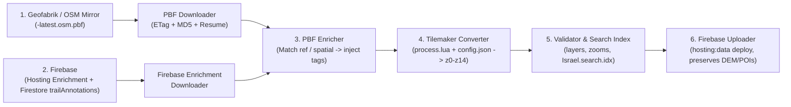

# NavApp — Standalone Local PBF-to-PMTiles Pipeline Implementation Plan

## 1. Overview & Goals

Build a **separate, standalone local PC service/application** (`tools/pbf-to-pmtiles/`) that automates the end-to-end map-build pipeline for NavApp:

1. **Standalone Local Service / App**: Runs independently on a local PC (Node.js/TypeScript HTTP service + web status UI on `http://localhost:4322` and a headless CLI), completely decoupled from the NavApp PWA/Capacitor bundle.
2. **Download Country `.osm.pbf` from the Web**: Fetches the latest OpenStreetMap `.osm.pbf` extract for a selected country (default: `israel-and-palestine` from Geofabrik) with ETag/MD5 verification and resumable streaming.
3. **Download Enrichment Data from Firebase**: Pulls NavApp's trail/map enrichment data from Firebase (Firebase Hosting data site + Firestore `trailAnnotations` / Storage) so custom trail metadata, numbers, colors, and overrides are preserved across every OSM rebuild.
4. **Enrich, Convert `.osm.pbf` → `.osm.pmtiles`, & Upload to Firebase**: Merges the enrichment data into the `.osm.pbf`, runs **Tilemaker** (native binary or Docker) to produce a NavApp-compliant OpenMapTiles `z0–z14` `.pmtiles` archive, validates the output, rebuilds `Israel.search.idx`, and deploys to Firebase Hosting (`hosting:data`).

---

## 2. End-to-End Pipeline Architecture



### Proposed Directory Structure
```text
tools/pbf-to-pmtiles/
├── package.json                  # Independent dependencies (express, pmtiles, firebase-admin/rest, etc.)
├── tsconfig.json
├── config/
│   ├── countries.json            # Country registry (geofabrik URLs, bbox, output prefix e.g. "Israel")
│   ├── tilemaker-config.json     # OpenMapTiles z0-z14 layer/zoom config
│   └── tilemaker-process.lua     # NavApp Lua profile (nature reserves fix + trail/enrichment tags)
├── src/
│   ├── cli.ts                    # CLI entrypoint: run, download-pbf, download-enrichment, convert, upload
│   ├── server.ts                 # Localhost HTTP service + SSE live job logs + Web UI (port 4322)
│   ├── steps/
│   │   ├── pbfDownloader.ts      # Streams .osm.pbf + .md5 from Geofabrik with resume & checksum check
│   │   ├── firebaseEnricher.ts   # Downloads enrichment file(s) from Firebase Hosting & Firestore
│   │   ├── pbfTagInjector.ts     # Applies enrichment tags onto matching OSM relations/ways -> enriched.osm.pbf
│   │   ├── tilemakerRunner.ts    # Invokes Tilemaker (native or Docker) to produce <Country>.osm.pmtiles
│   │   ├── pmtilesValidator.ts   # Verifies z0-z14 header, bounds, park/transportation layers & tags
│   │   └── firebaseUploader.ts   # Stages <Country>.osm.pmtiles + .search.idx and deploys to hosting:data
│   └── ui/                       # Lightweight local dashboard (select country, trigger run, view logs/history)
└── workspace/                    # Git-ignored working directory (downloaded .osm.pbf, enriched .pbf, outputs)
```

Plus a Windows convenience launcher:
- `devops/run-pbf-to-pmtiles.bat` — starts the local service and opens `http://localhost:4322` (or runs a one-shot build when passed `--run`).

---

## 3. Detailed Step-by-Step Design

### Step 1: Standalone Local Service & App (`server.ts` + `cli.ts`)
- **Job Runner & State Machine**: Manages pipeline runs (`idle` → `downloading_pbf` → `downloading_enrichment` → `enriching_pbf` → `converting_pmtiles` → `validating` → `uploading` → `completed` / `failed`), persisting run history and step timings locally in `workspace/runs.json`.
- **Live Progress Streaming**: Streams real-time stdout/stderr from downloads, Tilemaker, and Firebase CLI over **Server-Sent Events (SSE)** to the local web dashboard.
- **Step Checkpointing**: Supports `--skip-download` / `--from-step <step>` so a failed upload or Tilemaker tweak does not require re-downloading a multi-hundred-MB `.osm.pbf`.

### Step 2: Download Country `.osm.pbf` from the Web (`pbfDownloader.ts`)
- **Country Registry (`config/countries.json`)**: Maps a country key to its Geofabrik URL, `.md5` checksum URL, and output file prefix:
  - Default entry: `israel-and-palestine` → `https://download.geofabrik.de/asia/israel-and-palestine-latest.osm.pbf` (output prefix: `Israel`).
  - Extensible to any Geofabrik country/region (e.g., `cyprus`, `jordan`, `greece`, or custom `.osm.pbf` URL).
- **Caching & Integrity**:
  - Sends `HEAD` / `If-None-Match` (`ETag` / `Last-Modified`) to avoid redundant downloads when the upstream PBF has not changed.
  - Downloads `.osm.pbf.md5` and verifies the MD5 hash before proceeding.
  - Supports HTTP `Range` resume for interrupted downloads.

### Step 3: Download Enrichment File(s) from Firebase (`firebaseEnricher.ts`)
- **Sources**:
  1. **Firebase Hosting Data Site (`https://navapp-israel-topo-data.web.app`)**: Downloads the country's enrichment file (e.g., `Israel.enrichment.json` or `IsraelTrails.json` + `Israel.pois.geojson` using the same origin/probe pattern as [`map-data-common.mjs`](../script_helpers/map-data-common.mjs)).
  2. **Firebase Firestore (`trailAnnotations` collection)**: Optionally fetches all `status == 'active'` community trail annotations from Firestore (via Firebase REST API or Admin SDK) so community-edited trail colors, numbers, names, and descriptions are included in the enrichment bundle.
- **Normalization**: Merges both sources into a single deterministic `workspace/<country>.enrichment.json` file keyed by:
  - `wayIds` (`osm:way:<id>` from `trailAnnotations`)
  - `numbers` (SPNI trail `ref` numbers from [`IsraelTrails.json`](../../src/core/trails/IsraelTrails.json))
  - `(lon, lat)` spatial fallback coordinates.

### Step 4: Enrich `.osm.pbf` & Convert to `.osm.pmtiles`
#### 4a. PBF Tag Injection (`pbfTagInjector.ts`)
- Reads `<country>-latest.osm.pbf` + `<country>.enrichment.json` and writes `<country>-enriched.osm.pbf` (using `osmium` / `osm-pbf-parser` or a fast Node/Python/Rust PBF filter):
  - Matches OSM `relation` (`type=route`, `ref=<number>`) and `way` (`osm:way:<id>` or spatial proximity) elements.
  - Injects non-destructive enrichment tags (e.g., `colour`, `osmc:symbol`, `ref`, `name:he`, `navapp:description`, `navapp:hazard`, `navapp:activities`) without breaking existing OSM topology or node references.

#### 4b. Tilemaker Conversion (`tilemakerRunner.ts`)
- Runs **Tilemaker** (auto-detecting local `tilemaker` binary or falling back to `docker run --rm ... ghcr.io/systemed/tilemaker`) with:
  - `config/tilemaker-config.json` (`minzoom: 0`, `maxzoom: 14`, OpenMapTiles 19-layer schema matching [`osm-zoom-levels.md`](./osm-zoom-levels.md)).
  - `config/tilemaker-process.lua` incorporating:
    - All protected area / nature reserve fixes documented in [`tilemaker-nature-reserves-fix.md`](./tilemaker-nature-reserves-fix.md) (`boundary=protected_area`, `type=boundary` relations, `national_park` / `nature_reserve` class mapping).
    - Preservation of numeric OSM `way` IDs in the `transportation` layer (as required by [`trail-annotations-implementation-plan.md`](./trail-annotations-implementation-plan.md)) and emission of `colour`, `colour2`, `osmc_symbol`, `network`, and enrichment attributes.
- Outputs `workspace/<Country>.osm.pmtiles` directly (Tilemaker natively writes `.pmtiles` when output ends with `.pmtiles`).

#### 4c. Validation & Search Index (`pmtilesValidator.ts`)
- Reads the generated `.pmtiles` header and samples zoom-14 tiles to verify:
  - Valid PMTiles v3 magic header, non-zero tile count, `minZoom <= 0`, `maxZoom >= 14`, and expected country bounding box.
  - Required layers exist (`transportation`, `park`, `place`, `water`, `landuse`, `boundary`) and `park` contains `national_park` / `nature_reserve` features.
- Rebuilds `<Country>.search.idx` using [`build-pmtiles-search-index.mjs`](../script_helpers/build-pmtiles-search-index.mjs) so search stays in sync with the new map tiles.

### Step 5: Upload to Firebase (`firebaseUploader.ts`)
- Copies the validated `<Country>.osm.pmtiles` and `<Country>.search.idx` into `data/` and delegates deployment to the existing safe Firebase Hosting uploader [`upload-map-data.mjs`](../script_helpers/upload-map-data.mjs) (or calls `firebase deploy --only hosting:data` after preserving remote `Israel.dem.pmtiles` and `Israel.pois.geojson` in `deploy_data/data/`).
- Updates `data/.firebase-sync-meta.json` and records the deployed URL, file size, and SHA-256 in `workspace/runs.json`.
- Supports `--dry-run` (runs everything except the final Firebase deploy).

---

## 4. Local Web UI Design (`http://localhost:4322`)

The standalone service serves a single-page React + Vite dashboard (`tools/pbf-to-pmtiles/src/ui/`) so the operator can configure, run, monitor, and inspect every stage visually without touching the terminal.

### 4.1 Screen Layout & Panels
```text
┌─────────────────────────────────────────────────────────────────────────┐
│ Top Bar: NavApp PBF → PMTiles Builder   [Environment: Local]  [Status]  │
├───────────────────────────────┬─────────────────────────────────────────┤
│ Left Panel: Run Configuration │ Right Panel: Pipeline Stepper & Logs    │
│                               │                                         │
│ 1. Country / Extract          │  (1) Download PBF       [✓ 42s  118 MB] │
│    [Israel & Palestine ▼]     │  (2) Firebase Enrich    [✓  4s  2,150]  │
│    URL: geofabrik... (auto)   │  (3) Inject Tags (PBF)  [● Running...]  │
│    [ ] Force re-download PBF  │  (4) Tilemaker → PMTiles[  Pending   ]  │
│                               │  (5) Validate & Index   [  Pending   ]  │
│ 2. Enrichment Sources         │  (6) Upload to Firebase [  Skipped   ]  │
│    [x] Firebase Hosting JSON  │                                         │
│    [x] Firestore Annotations  │ ─────────────────────────────────────── │
│                               │ Live Log Console (SSE stream)           │
│ 3. Build & Upload Options     │ > [17:31:02] Matched 1,949 SPNI refs... │
│    Tilemaker: [Auto/Docker ▼] │ > [17:31:04] Writing enriched PBF...    │
│    Zooms: z0 – z14            │                                         │
│    [x] Rebuild Search Index   │ ─────────────────────────────────────── │
│    [x] Dry-Run (No Upload)    │ Validation Summary Card (on completion) │
│                               │  • Output: Israel.osm.pmtiles (114 MB)  │
│ [ ▶ Start Full Pipeline ]     │  • Layers: transportation, park, ...    │
│ [ ■ Cancel Run ]              │  • [ Deploy to Firebase Now ] (manual)  │
├───────────────────────────────┴─────────────────────────────────────────┤
│ Bottom Drawer: Run History (Timestamp, Country, Sizes, SHA-256, Status) │
└─────────────────────────────────────────────────────────────────────────┘
```

### 4.2 Core UI Features
1. **Country Selector & Cache Status**: Dropdown populated from `config/countries.json` (plus a `"Custom PBF URL"` option), showing whether a cached `.osm.pbf` exists locally, its `ETag`/date, and file size.
2. **Enrichment Preview**: Displays counts of loaded Firebase enrichment records (Hosting JSON trails + active Firestore `trailAnnotations`) and matched vs. unmatched OSM elements before/after injection.
3. **Interactive 6-Step Pipeline Stepper**: Visual progress bar per step with elapsed time, byte/feature counters, and ability to **"Resume from Step"** if a step fails.
4. **Live SSE Log Console**: Auto-scrolling terminal output with log-level filtering (`Info`, `Warn`, `Error`), search, and `"Copy Logs"` button.
5. **Two-Step Safe Upload**:
   - Users can run with **`Dry-Run (No Upload)`** checked, inspect the **Validation Summary Card** (zoom range `z0–z14`, `park` reserve count, `transportation` trail count, file size delta vs. current Firebase Hosting file), and then click **`Deploy to Firebase Now`** when satisfied.
6. **Run History Table**: Lists past builds from `workspace/runs.json` with country, duration, output size, SHA-256, and Firebase deploy status.

### 4.3 Backend HTTP & SSE API Contract (`server.ts`)
| Endpoint | Method | Purpose |
| :--- | :--- | :--- |
| `/api/config` | `GET` | Returns available countries, Tilemaker mode (native/Docker), and cached PBF status |
| `/api/runs` | `GET` | Returns past runs from `workspace/runs.json` and current active job state |
| `/api/runs` | `POST` | Starts a pipeline run (`{ countryKey, customUrl?, forceDownload, includeFirestore, dryRun, fromStep? }`) |
| `/api/runs/:id/cancel` | `POST` | Gracefully terminates the active child process (Download / Tilemaker / Firebase CLI) |
| `/api/runs/:id/deploy` | `POST` | Triggers `firebaseUploader.ts` for a completed dry-run build |
| `/api/runs/:id/events` | `GET` | **SSE stream** pushing step status transitions, progress %, and log lines in real time |

---

## 5. Phased Implementation Plan

### Phase 1: Scaffold & Country PBF Downloader
- Create `tools/pbf-to-pmtiles/` with TypeScript config, `config/countries.json`, and `pbfDownloader.ts` (Geofabrik streaming, ETag cache, MD5 verification).
- Unit test URL resolution, ETag skip logic, and MD5 verification.

### Phase 2: Firebase Enrichment Downloader & PBF Tag Injector
- Implement `firebaseEnricher.ts` (pulling enrichment JSON from `navapp-israel-topo-data.web.app` + optional Firestore `trailAnnotations`).
- Implement `pbfTagInjector.ts` to merge enrichment tags into `<country>-enriched.osm.pbf` with unit tests on sample `.osm.pbf` / JSON fixtures.

### Phase 3: Tilemaker Profile, Runner & Validator
- Author `config/tilemaker-config.json` and `config/tilemaker-process.lua` (aligned with [`tilemaker-nature-reserves-fix.md`](./tilemaker-nature-reserves-fix.md) and [`osm-zoom-levels.md`](./osm-zoom-levels.md)).
- Implement `tilemakerRunner.ts` (native + Docker fallback) and `pmtilesValidator.ts` + search index rebuild integration.

### Phase 4: Firebase Uploader, Local Web Service, UI & Launcher
- Implement `firebaseUploader.ts` integrating safely with [`upload-map-data.mjs`](../script_helpers/upload-map-data.mjs).
- Build `server.ts` (Express + REST API + SSE logs on port `4322`) and `src/ui/` (React dashboard with Country Selector, 6-step Stepper, SSE Log Console, Validation Summary Card, and Run History).
- Add `cli.ts` and `devops/run-pbf-to-pmtiles.bat`.

---

## 6. Verification & Acceptance Criteria

1. **Dry-Run End-to-End**: Running via UI or `cli --country israel-and-palestine --dry-run` downloads `israel-and-palestine-latest.osm.pbf`, pulls the Firebase enrichment file, produces `Israel.osm.pmtiles` + `Israel.search.idx`, and passes all PMTiles layer/zoom validation checks without uploading.
2. **UI Live Streaming & Controls**: Starting a run from `http://localhost:4322` streams real-time SSE logs, updates all 6 stepper states, supports cancelling mid-run, and enables one-click **`Deploy to Firebase Now`** after a dry-run.
3. **Enrichment Preservation**: Sample trails from the Firebase enrichment file appear in the generated `Israel.osm.pmtiles` `transportation` tiles with their expected attributes.
4. **Safe Firebase Hosting Deploy**: Uploading `Israel.osm.pmtiles` to `hosting:data` preserves existing remote `Israel.dem.pmtiles` and `Israel.pois.geojson` on `https://navapp-israel-topo-data.web.app`.
5. **Zero NavApp Bundle Impact**: Root `npm run build` and `npm test` remain completely unaffected.
