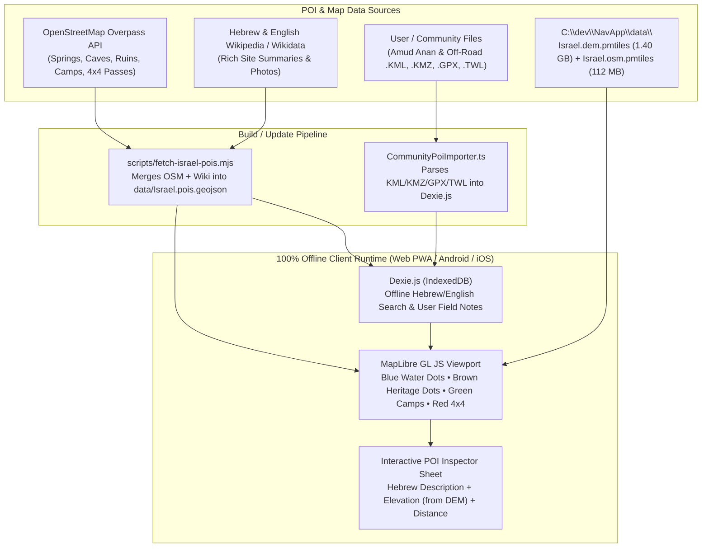

# NavApp: Cross-Platform Outdoor Map Navigation — Implementation Plan

## 1. Vision & Architectural Overview
**NavApp** is a 100% serverless, offline-capable cross-platform outdoor map navigation application targeting **Web (PWA on Firebase Hosting)**, **Android**, and **iOS** from a single shared TypeScript codebase. It combines architectural lessons from:
- **[IsraelHikingMap (Mapeak)](https://israelhiking.osm.org.il/)**: Cross-platform SPA + Ionic Capacitor shell, split static DEM vs. dynamic OSM vector map layers, Overpass + Wikipedia/Wikidata POI enrichment, IndexedDB (`Dexie.js`) offline state, `@turf/turf` spatial geometry engine, and GPX route planning.
- **[Off-Road.io](https://off-road.io/) & [Amud Anan](https://amudanan.co.il/)**: Rich clickable backcountry Points of Interest (blue water/spring points, brown archaeological/historical points, green night campsites, red 4x4 ascents/passes/obstacles) with community field descriptions and support for importing `.kml`, `.kmz`, `.gpx`, `.twl`, and `.geojson` waypoint collections.
- **[MapLibre GL JS](https://github.com/maplibre/maplibre-gl-js)**: Hardware-accelerated WebGL vector/raster/DEM rendering, custom `addProtocol` hooks, 3D terrain extrusion, on-the-fly DEM contour lines (`maplibre-contour`), and self-hosted offline sprites & PBF font glyphs.
- **[Protomaps PMTiles](https://github.com/protomaps/pmtiles)**: Single-file serverless tile archives read on-demand via byte-range requests (`offset`, `length`), supporting both remote cloud URLs (`FetchSource`) and local device storage (`FileSource` / OPFS / Native Random-Access File Slicing).

---

## 2. Tri-Layer Offline Data Architecture (`C:\dev\NavApp\data\`)
Why `Israel.osm.pmtiles` alone isn't enough for rich POIs: Inspecting the `poi` layer inside `Israel.osm.pmtiles` shows it only carries compact rendering tags (`class`, `subclass`, `name:latin`, `rank`) and strips out Hebrew/English descriptions (`description:he`, `note`, `wikipedia` summaries, spring water status, and 4x4 pass notes) to keep vector tiles small.

Therefore, `C:\dev\NavApp\data\` uses a **3-file decoupled offline architecture**:

| File in `C:\dev\NavApp\data\` | Size | Lifecycle Policy | Technical Specification & Purpose |
| :--- | :--- | :--- | :--- |
| **[`Israel.dem.pmtiles`](file:///c:/dev/NavApp/data/Israel.dem.pmtiles)** | **1.40 GB** (`1,402,183,369` B) | **Constant / Immutable** — Installed or downloaded **once**. Never re-downloaded when maps or POIs update. | **PMTiles v3**, `TileType: 2` (`png`), `encoding: "terrarium"`, `tileSize: 256px`, `z0–z14`, Bounds: `[34.1166, 29.4193, 36.0064, 33.3848]`. Powers **Hillshade**, **3D Terrain**, **Dynamic Contour Lines (`maplibre-contour`)**, and **Offline Route Elevation Profiles**. |
| **[`Israel.osm.pmtiles`](file:///c:/dev/NavApp/data/Israel.osm.pmtiles)** | **112.4 MB** (`112,434,955` B) | **Updatable / Hot-Swappable** — Updated periodically from OpenStreetMap and atomically replaces the old `Israel.osm.pmtiles` (~112 MB download instead of 1.5 GB). | **PMTiles v3**, `TileType: 1` (`mvt`, Gzip), `z0–z14`, **OpenMapTiles schema** (`Tilemaker`) with `extract.createdUtc` version timestamp. Contains 19 vector layers: `transportation` (with `tracktype`, `sac_scale`, `mtb_scale`, `smoothness`, `incline`), `transportation_name`, `poi`, `mountain_peak`, `park`, `water`, `waterway`, `landcover`, `landuse`, `fuel_line`, `flood_defence`, `building`, `housenumber`, `place`, `boundary`, `admin_area`, `aeroway`, `aerodrome_label`, `water_name`. |
| **`Israel.pois.geojson`** *(Generated & Updatable)* | **~4–8 MB** | **Updatable + User-Extensible** — Harvested from the shared OpenStreetMap / Overpass / Wikipedia / Wikidata ecosystem used by Israel Hiking & Off-Road, plus user-imported KML/GPX/TWL files. | Contains rich offline Points of Interest with **Hebrew & English names (`name:he`, `name:en`)**, **full descriptions (`description:he`, `note`, Wikipedia abstracts)**, **categories** (Blue = Springs/Water/Cisterns, Brown = Ruins/Caves/Memorials/Viewpoints, Green = Night Campsites, Red = 4x4 Ascents `מעלה`/Obstacles/Gates), and **offline full-text search index** in `Dexie.js`. |

---

## 3. Importing & Unifying POIs from Israel Hiking, Off-Road.io & Amud Anan

### How Data from the 3 Platforms Relates & How We Import It Legally and Cleanly:
1. **Shared Open Data Core (`scripts/fetch-israel-pois.mjs` → `data/Israel.pois.geojson`)**:
   - **Israel Hiking Map (`israelhiking.osm.org.il`)** and **Off-Road.io** source their base trail network, springs, caves, viewpoints, campsites, 4x4 ascents (`מעלה`), and historical landmarks from **OpenStreetMap Israel** combined with **Hebrew/English Wikidata & Wikipedia** and **INPA (Nature Reserves)**.
   - We will build an automated Node.js harvester script (`scripts/fetch-israel-pois.mjs`) that queries the **Overpass API** + **Hebrew/English Wikipedia GeoSearch & Wikidata API** across the Israel bounding box `[29.41, 34.11, 33.38, 36.01]` to extract:
     - **Water & Springs (Blue Dots — Amud Anan / Israel Hiking style)**: `natural=spring`, `man_made=water_well`, `man_made=cistern`, `water=pond/reservoir`, `amenity=drinking_water` — including `name:he`, `description:he`, `note`, `seasonal`, `drinking_water`, and Wikipedia descriptions.
     - **Heritage, Caves & Viewpoints (Brown Dots)**: `historic=archaeological_site|ruins|monument|memorial|tomb|castle`, `natural=cave_entrance`, `tourism=viewpoint|attraction`.
     - **Campsites & Shelters (Green Dots)**: `tourism=camp_site`, `tourism=alpine_hut|wilderness_hut`, `amenity=shelter`, `backcountry=yes`.
     - **4x4 Passes, Ascents & Obstacles (Red/Orange Markers — Off-Road style)**: `mountain_pass=yes`, named 4x4 ascents (`מעלה`), `Smoothness=impassable|very_horrible`, `ford=yes`, `barrier=gate|block|boulder`.
2. **Community File Importer (Amud Anan / Off-Road / Israel Hiking Exports)**:
   - While Amud Anan's proprietary backend database is copyright-protected against bulk scraping, hikers and 4x4 drivers export and share `.kml`, `.kmz`, `.gpx`, `.twl` (TurboCD/Amud Anan format), and `.geojson` files containing custom waypoints and descriptions.
   - Our **`CommunityPoiImporter.ts`** parses `<wpt>` (GPX), `<Placemark>` (KML/KMZ with HTML descriptions), `.twl`, and GeoJSON files directly into `Dexie.js` IndexedDB so users can load any Amud Anan / Off-Road / Israel Hiking waypoint collection into NavApp for 100% offline use!
3. **User Offline Field Notes & Crowd Updates**:
   - Users can tap any POI on the map (or drop a new pin) while offline in the field to save personal/shared notes (e.g., *"עין עקב - בריכה מלאה ונקייה"*), stored locally in `Dexie.js` and optionally synced via **Firebase Firestore (Free Tier)** when back online.



---

## 4. Recommended Tech Stack (Serverless + Firebase Free Tier Ready)
| Layer | Technology | Rationale |
| :--- | :--- | :--- |
| **App Framework & Build** | **React 19 + TypeScript + Vite + PWA (`vite-plugin-pwa`)** | Fast HMR, offline Service Worker caching, and tiny static bundle (~4 MB) for Firebase Hosting. |
| **Map Rendering Engine** | **MapLibre GL JS (`maplibre-gl`) + `maplibre-contour`** | WebGL vector & 3D terrain rendering plus dynamic contour lines generated directly from `Israel.dem.pmtiles`. |
| **Tile Archive Format** | **Protomaps PMTiles (`pmtiles`)** | Serverless byte-range reading (`offset`, `length`) for both `Israel.osm.pmtiles` and `Israel.dem.pmtiles`. |
| **Mobile Native Runtime** | **Ionic Capacitor (`@capacitor/core`, `@capacitor/android`, `@capacitor/ios`)** | Packages the web app into native Android & iOS apps with native file I/O and background GPS. |
| **Local Metadata, POI & GPX DB** | **Dexie.js (IndexedDB)** | Stores `Israel.pois.geojson` for instant offline Hebrew/English search, KML/GPX imports, and map version metadata. |
| **Spatial & Elevation Math** | **Turf.js (`@turf/turf`)** | Client-side distance, bearing, route snapping, off-route alerts, and elevation profile sampling. |
| **Serverless Hosting** | **Firebase Hosting (Spark Free Tier) + Optional Firestore** | Hosts the static PWA for \$0; optional free-tier Firestore for syncing user-contributed POI notes. |

---

## 5. Proposed Project Directory Structure (`C:\dev\NavApp`)
```text
C:\dev\NavApp\
├── .agents/
│   └── skills/
│       └── outdoor-map-navigation/       # Expert Agent Skill & Reference Docs
├── data/                                 # Local Map & POI Archives
│   ├── Israel.dem.pmtiles                # [CONSTANT - 1.40 GB] Terrarium 10m DEM (z0-z14)
│   ├── Israel.osm.pmtiles                # [UPDATABLE - 112 MB] OpenMapTiles Vector (z0-z14)
│   └── Israel.pois.geojson               # [HARVESTED - ~5 MB] Rich Hebrew/English POIs & Descriptions
├── scripts/
│   └── fetch-israel-pois.mjs             # Harvests Overpass OSM + Hebrew Wikipedia POIs into data/Israel.pois.geojson
├── public/
│   ├── assets/
│   │   ├── fonts/                        # Offline PBF glyphs (Noto Sans Hebrew + Regular/Bold)
│   │   └── sprites/                      # Offline outdoor SVG sprites (springs, caves, camps, 4x4)
│   └── manifest.webmanifest              # PWA offline manifest
├── src/
│   ├── core/
│   │   ├── pmtiles/
│   │   │   ├── PMTilesRegistry.ts        # Mounts Israel.dem.pmtiles (static) & Israel.osm.pmtiles (updatable)
│   │   │   ├── MapUpdateManager.ts       # Compares metadata.extract.createdUtc & hot-swaps Israel.osm.pmtiles
│   │   │   ├── NativeSliceSource.ts      # Capacitor random-access byte-range Source
│   │   │   └── OpfsStorageAdapter.ts     # Web Origin Private File System manager
│   │   ├── pois/
│   │   │   ├── PoiManager.ts             # Loads Israel.pois.geojson + indexes Hebrew/English search in Dexie
│   │   │   └── CommunityPoiImporter.ts   # Imports Amud Anan / Off-Road / Israel Hiking KML, KMZ, GPX, TWL
│   │   ├── style/
│   │   │   ├── israelOutdoorStyle.ts     # OpenMapTiles 19-layer outdoor style + Terrarium DEM + Contours
│   │   │   └── trailLayers.ts            # Hiking trails, 4x4 tracks, fuel_line, mountain_peak, parks, POIs
│   │   ├── navigation/
│   │   │   ├── GpsTracker.ts             # Web + Capacitor background location & compass heading
│   │   │   ├── RouteManager.ts           # GPX/KML/GeoJSON import/export & Turf.js snapping
│   │   │   └── ElevationService.ts       # Decodes Terrarium PNG pixels from Israel.dem.pmtiles
│   │   └── db/
│   │       └── NavDatabase.ts            # Dexie.js schema (maps, pois, userNotes, routes, tracks)
│   ├── components/
│   │   ├── map/
│   │   │   ├── MapViewport.tsx           # MapLibre canvas centered on Israel [35.0615, 31.4020]
│   │   │   └── LayerSwitcherSheet.tsx    # Toggle Hillshade, 3D, Contours, Blue/Brown/4x4 POI Dots
│   │   ├── pois/
│   │   │   ├── PoiInspectorSheet.tsx     # Rich modal showing Hebrew description, Wiki summary, DEM altitude & user notes
│   │   │   └── PoiSearchBar.tsx          # Instant offline Hebrew/English search across all POIs & peaks
│   │   ├── maps-manager/
│   │   │   └── MapStorageModal.tsx       # Manages Israel.dem (Constant), Israel.osm (Updatable), & POI Sync
│   │   └── navigation/
│   │       ├── ElevationProfileDrawer.tsx # Interactive route elevation chart from Israel.dem.pmtiles
│   │       └── TrackRecorderBar.tsx      # Live speed, distance, ascent, and off-route warning
│   ├── App.tsx
│   └── main.tsx
├── firebase.json                         # Firebase Hosting config (SPA rewrites + Range/CORS headers)
├── capacitor.config.ts
├── package.json
├── tsconfig.json
└── vite.config.ts                        # Includes custom dev middleware serving C:\dev\NavApp\data\* with HTTP 206
```

---

## 6. Phased Implementation Roadmap

### Phase 1: Project Scaffolding & Dual-PMTiles Engine (`Israel.dem` + `Israel.osm`)
1. **Initialize Vite + React + TypeScript + Tailwind CSS** project in `C:\dev\NavApp`.
2. **Vite Dev Byte-Range Server Middleware (`vite.config.ts`)**:
   - Mount `C:\dev\NavApp\data\Israel.dem.pmtiles`, `C:\dev\NavApp\data\Israel.osm.pmtiles`, and `C:\dev\NavApp\data\Israel.pois.geojson` at `/data/*` with full `HTTP 206 Partial Content` (`Range: bytes=start-end`) support.
3. **Implement `PMTilesRegistry` & `MapUpdateManager`**:
   - Register `Israel.dem.pmtiles` as a **constant** `raster-dem` source (`encoding: "terrarium"`, `tileSize: 256`, `maxzoom: 14`) and bind `maplibre-contour` (`dem-contour://`) to generate 10m/50m contour lines directly from `Israel.dem.pmtiles`.
   - Register `Israel.osm.pmtiles` as an **updatable** `vector` source (`maxzoom: 14`), reading its `extract.createdUtc` timestamp and allowing zero-downtime replacement when a newer `Israel.osm.pmtiles` is loaded.

### Phase 2: OpenMapTiles Outdoor Cartography for Israel (`israelOutdoorStyle.ts`)
1. **Bundle Offline Hebrew + Latin Fonts & Outdoor Sprites**:
   - Package PBF glyphs supporting Hebrew, Arabic, and Latin scripts (`Noto Sans Regular` / `Bold`) in `public/assets/fonts/`.
2. **Style All 19 Vector Layers in `Israel.osm.pmtiles` + Terrarium DEM**:
   - Style `transportation` using its rich embedded attributes (`tracktype`, `sac_scale`, `mtb_scale`, `smoothness`, `incline`, `surface`, `trail_visibility`) to distinguish paved roads, 4x4 dirt tracks, MTB singletracks, and hiking footpaths.
   - Style `landcover` (`leaf_type`), `park`, `fuel_line`, `water`, `waterway`, `mountain_peak` (`ele`), and `poi`.

### Phase 3: POI Harvester & Community Importer (Israel Hiking / Off-Road / Amud Anan)
1. **Build & Run `scripts/fetch-israel-pois.mjs`**:
   - Fetch and compile rich Israeli outdoor POIs (springs, cisterns, wells, caves, archaeological ruins, viewpoints, campsites, 4x4 ascents/obstacles) with Hebrew/English names, `description:he`, `note`, and Wikipedia links into `C:\dev\NavApp\data\Israel.pois.geojson`.
2. **Interactive POI Layer & Inspector (`PoiManager.ts` + `PoiInspectorSheet.tsx`)**:
   - Render color-coded interactive POI dots on the map (Blue = Water/Springs, Brown = Heritage/Caves/Lookouts, Green = Night Camps, Red = 4x4 Passes/Hazards) that can be toggled on/off like Amud Anan and Off-Road.io.
   - Clicking any POI opens the inspector drawer with full Hebrew/English description, exact elevation from `Israel.dem.pmtiles`, distance/bearing from user, and personal field notes.
   - Instant **100% offline Hebrew & English search bar** (`PoiSearchBar.tsx`) searching across all springs, peaks, ruins, campsites, and user waypoints.
3. **Import KML / KMZ / GPX / TWL Community Files (`CommunityPoiImporter.ts`)**:
   - Allow drag-and-drop or file-picker import of waypoint/route files exported from Amud Anan, Off-Road.io, or Israel Hiking Map.

### Phase 4: Offline Storage Manager, GPX Navigation & Elevation Profiles
1. **Storage Manager (`MapStorageModal.tsx`)**:
   - Independent status & update controls for **Constant `Israel.dem.pmtiles` (1.40 GB)**, **Updatable `Israel.osm.pmtiles` (112.4 MB)**, and **Updatable `Israel.pois.geojson`**.
2. **Offline DEM Elevation Decoder (`ElevationService.ts`) & GPS Tracker (`GpsTracker.ts`)**:
   - Samples `Israel.dem.pmtiles` Terrarium PNG tiles directly (`elevation = (R * 256 + G + B / 256) - 32768`) for route elevation graphs, total climb/descent, and off-route alerts.

### Phase 5: Serverless Firebase Hosting & Capacitor Android/iOS Packaging
1. **Firebase Hosting Configuration (`firebase.json`)** for free-tier static PWA deployment.
2. **Capacitor Android & iOS Setup (`capacitor.config.ts`)** with native random-access byte-range reading for `Israel.dem.pmtiles` and `Israel.osm.pmtiles`.
