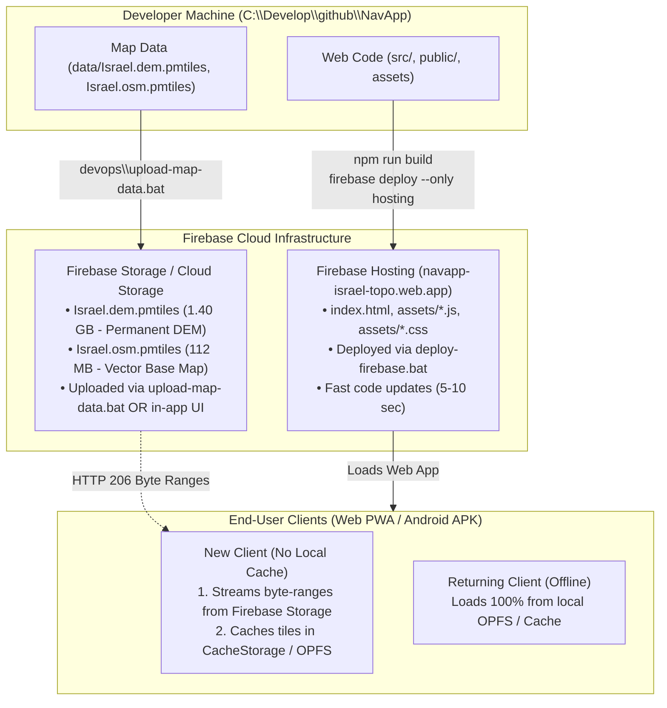

# Implementation Plan: Decoupling Code Deployment & Firebase Map Data Storage

## Executive Summary
This plan completely separates **Code Deployment** from **Map Data Storage**:
1. **Code Deployments (`devops/deploy-firebase.bat`)**: Strictly deploy the web application (`dist/`: HTML, JS, CSS, icons, service worker). They do **NOT** touch, copy, delete, or require the large `.pmtiles` map data.
2. **Dedicated Map Data Upload Script (`devops/upload-map-data.bat`)**: An independent script dedicated solely to uploading/updating `Israel.dem.pmtiles`, `Israel.osm.pmtiles`, and GeoJSON datasets to Firebase. Run on-demand only when map data changes.
3. **Client Fast Loading vs. Manual UI Update Architecture**:
   - **Section 1 (New Clients / Fast Initial Load)**: New users without cached data stream HTTP byte-ranges on-demand from Firebase. Visited tiles are stored in browser CacheStorage / OPFS so subsequent loads are instant and work 100% offline.
   - **Section 2 (Manual OSM Update from UI)**: The UI card (`MapStorageModal.tsx`) will provide both local device replacement and an option to upload the new `Israel.osm.pmtiles` to Firebase Storage so all clients receive the update.

---

## 1. Architectural Overview: Decoupling Code & Data



---

## 2. Proposed Changes & Action Items

### Task 1: Decouple Code Deployment (`devops/deploy-firebase.bat`)
- **Remove all `.pmtiles` dependencies and the safety interlock block** from `deploy-firebase.bat`.
- The code deployment script will:
  1. Generate offline PWA assets (`generate-offline-assets.mjs`).
  2. Build production web bundle (`npm run build`).
  3. Copy only small offline vector assets (POI/trail GeoJSON, sprites, fonts) into `dist/`.
  4. Run `npx firebase-tools deploy --only hosting`.
- **Result**: Code deployments run in ~5–10 seconds and can **never delete or touch** `Israel.dem.pmtiles` or `Israel.osm.pmtiles`.

### Task 2: Create Dedicated Map Data Upload Script (`devops/upload-map-data.bat`)
- Create a standalone tool:
  - `devops/upload-map-data.mjs` (Node.js engine)
  - `devops/upload-map-data.bat` (one-click Windows runner)
- **Features**:
  - Checks `data/` for `Israel.dem.pmtiles` and `Israel.osm.pmtiles`.
  - Supports uploading **all map data** or **only `Israel.osm.pmtiles`** (when vector layers are updated).
  - Uses resumable chunked upload with a progress bar.
  - Automatically sets required HTTP headers on the uploaded objects:
    - `Content-Type: application/octet-stream`
    - `Cache-Control: public, max-age=86400`
    - `Accept-Ranges: bytes`
    - `Access-Control-Allow-Origin: *`

### Task 3: Client Fast Loading Architecture (Section 1)
- **Fast Startup for New Users**:
  - When a client opens NavApp with an empty cache, it streams only the few header bytes (~16 KB) and directory index (~30 KB) from Firebase Storage.
  - As the user pans and zooms, `CachedFetchSource` issues HTTP 206 Range requests for individual tiles (10–50 KB each) instead of downloading 112 MB or 1.4 GB upfront.
  - Tiles are rendered immediately on the screen within milliseconds.
  - Background caching automatically saves fetched ranges into CacheStorage (`pmtiles-range-cache-v2`).
- **Offline Resilience**:
  - If the user goes into the field without internet, all previously viewed areas remain in cache.
  - If the user clicks "שמור אופליין", the app downloads the complete archive into OPFS for 100% offline coverage across all of Israel.

### Task 4: In-App UI Manual Update for `Israel.osm.pmtiles` (Section 2)
In `src/components/maps-manager/MapStorageModal.tsx`:
- On the `data/Israel.osm.pmtiles` card:
  - **Button 1 (Local Device Update)**: `החלף / עדכן קובץ מקומי (OPFS)` — loads the user's local `.pmtiles` file into this specific device's persistent storage.
  - **Button 2 (Cloud Update)**: `העלה ל-Firebase Storage` — allows uploading the newly generated `Israel.osm.pmtiles` to Firebase Storage directly from the browser (with upload progress bar). Once uploaded, **every client** automatically streams the new vector map!

---

## 3. Firebase Storage Bucket Configuration

To ensure Firebase Storage allows direct streaming and browser uploads:
1. **Enable Cloud Storage in Firebase Console**:
   - Go to [Firebase Console](https://console.firebase.google.com/project/navapp-israel-topo/storage) $\to$ **Storage** $\to$ click **Get Started**.
   - Default bucket will be created: `navapp-israel-topo.firebasestorage.app` (or `navapp-israel-topo.appspot.com`).
2. **CORS Rules (`devops/storage-cors.json`)**:
   Enables MapLibre and PMTiles in any browser to issue byte-range queries:
   ```json
   [
     {
       "origin": ["*"],
       "method": ["GET", "HEAD", "PUT", "POST"],
       "responseHeader": ["Content-Range", "Accept-Ranges", "Content-Length", "ETag"],
       "maxAgeSeconds": 3600
     }
   ]
   ```
3. **Public Read Rules (`storage.rules`)**:
   Allows read streaming of map files without authentication, with write access for uploads:
   ```javascript
   rules_version = '2';
   service firebase.storage {
     match /b/{bucket}/o {
       match /data/{allPaths=**} {
         allow read: if true;
         allow write: if true;
       }
     }
   }
   ```

---

## 4. Verification Plan

| Phase | Test / Action | Expected Result |
| :--- | :--- | :--- |
| **Code Deploy** | Run `deploy-firebase.bat` without `data/*.pmtiles` present | Deploys web code in seconds; does not fail; does not wipe remote map files |
| **Data Script** | Run `devops/upload-map-data.bat` | Uploads map files to Firebase Storage with progress tracking |
| **Fast Load** | Open web app in an incognito browser window | Map streams instantly via HTTP 206 ranges from Firebase Storage |
| **UI Update** | Use "העלה ל-Firebase Storage" in Maps Manager modal | Uploads new OSM file to cloud; all clients reflect updated vector layers |
