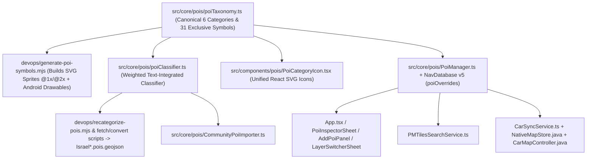

# NavApp — POI Refactoring Implementation Plan

> [!IMPORTANT]
> This plan pairs with [poi_refactoring_prds.md](./poi-refactoring-prds.md). **No source code or dataset edits have been made yet**—awaiting your approval before implementation.

---

## Architecture Overview

---

## Phase 1: Canonical 1-to-1 Taxonomy & Modern Symbol Asset Pipeline

### 1.1 Canonical Taxonomy Registry
- **[NEW] [src/core/pois/poiTaxonomy.ts](../src/core/pois/poiTaxonomy.ts)**
  - Define exact 6 categories (`water`, `offroad`, `campsite`, `heritage`, `peak`, `user`) and the **31 exclusive symbols** defined in PRD-1 §1.3 (`poi-water-*`, `poi-offroad-*`, `poi-campsite-*`, `poi-heritage-*`, `poi-peak-*`, `poi-user-*`).
  - Export typed helpers:
    - `CATEGORY_META`: colors (day/dark), labelHe, labelEn, defaultSubcategory, defaultSymbolId, silhouetteShape (`circle-drop` | `diamond-shield` | `rounded-square` | `octagon` | `triangle` | `pin-star`).
    - `SYMBOL_DEFINITIONS`: maps each of the 31 symbol IDs to `{ category, defaultSubcategory, aliases, heLabel, iconShapeSpec }` where every symbol belongs to **strictly 1** `PoiCategory`.
    - `resolvePoiSymbolId(category, subcategory)` and `normalizeSubcategoryForCategory(category, subcategory)`: guarantees **zero cross-category symbol leakage** and enforces category-specific fallbacks instead of legacy global `'viewpoint'`.
    - `toCompactSymbolKey` or direct sprite ID mapping for MapLibre expressions.

### 1.2 Modern Symbol Generator & Sprite Pipeline
- **[NEW] [devops/poi-symbols/](../devops/poi-symbols/)** + **[NEW] [devops/generate-poi-symbols.mjs](../devops/generate-poi-symbols.mjs)**
  - Author clean, high-contrast modern SVG definitions (36×36 logical `@1x`, 72×72 `@2x`) for all 31 exclusive symbols with:
    - Distinct per-category outer geometry + rich vibrant fill + crisp `2px` white/light outer halo + subtle shadow for maximum contrast on bright topo, dark topo, and satellite imagery.
  - Script deterministically packs/merges the 31 `poi-*` glyphs into:
    - [public/assets/sprites/sprite.json](../public/assets/sprites/sprite.json) & [public/assets/sprites/sprite.png](../public/assets/sprites/sprite.png)
    - [public/assets/sprites/sprite@2x.json](../public/assets/sprites/sprite@2x.json) & [public/assets/sprites/sprite@2x.png](../public/assets/sprites/sprite@2x.png)
    - Standalone PNG assets (or synced sprite manifest) for Android Auto in `android/app/src/main/assets/` / `res/drawable-nodpi/`.
  - Note: Preserve existing non-POI vector map sprites (trail shields, highway shields, road icons) in the sprite atlas untouched.

### 1.3 React UI Icon Component & Emoji Replacement
- **[NEW] [src/components/pois/PoiCategoryIcon.tsx](../src/components/pois/PoiCategoryIcon.tsx)**
  - Crisp inline SVG component rendering any `(category, subcategory)` pair using the exact visual geometry and palette as MapLibre map markers (with size presets `xs` | `sm` | `md` | `lg`).
- **[MODIFY] [src/components/ui/themeTokens.ts](../src/components/ui/themeTokens.ts)**
  - Align `POI_CATEGORY_META` colors/badges with `poiTaxonomy.ts` and preserve optional text fallback labels without relying on raw OS emojis in primary badges.
- **[MODIFY] UI Consumers:**
  - [src/components/map/LayerSwitcherSheet.tsx](../src/components/map/LayerSwitcherSheet.tsx) (6 category toggles render `<PoiCategoryIcon />`).
  - [src/components/pois/AddPoiPanel.tsx](../src/components/pois/AddPoiPanel.tsx) (6 category selector buttons + exclusive subcategory/symbol chips for the chosen category).
  - [src/components/search/SearchBar.tsx](../src/components/search/SearchBar.tsx) & [src/components/navigation/ElevationProfileDrawer.tsx](../src/components/navigation/ElevationProfileDrawer.tsx) & [src/App.tsx](../src/App.tsx) nearby cards (render `<PoiCategoryIcon />` next to POI items).

### 1.4 MapLibre Styling Cleanup
- **[MODIFY] [src/App.tsx](../src/App.tsx)**
  - Replace legacy sprite mapping & tiny 24×24 canvas icons (`offroad-pass`, `offroad-blocked`, `offroad-danger`) with a clean `poiIconExpression` generated directly from `poiTaxonomy.ts` mapping each category + exclusive subcategory strictly to `poi-<cat>-<slug>` with per-category exclusive fallback (`['match', ['get', 'category'], 'water', 'poi-water-spring', 'offroad', 'poi-offroad-pass', ...]`).
  - Precompute or embed `symbolId` cleanly in `toCompactMapGeoJSON` so MapLibre doesn't even duplicate complex giant `match` trees unless needed as fallback.
- **[MODIFY] [src/core/style/israelOutdoorStyle.ts](../src/core/style/israelOutdoorStyle.ts)**
  - Audit base vector tile POI layers (`navappLayer.json`) under `applyOutdoorStylePreferences` so built-in tile icons never contradict user category overrides/deletions or confuse category toggles.

---

## Phase 2: Text-Integrated POI Classifier & Dataset Migration

### 2.1 Shared Text-Integrated Classification Engine
- **[NEW] [src/core/pois/poiClassifier.ts](../src/core/pois/poiClassifier.ts)**
  - Pure TypeScript module with zero browser-only dependencies (runs identically in Vitest, browser runtime, and Node scripts via `npx tsx`).
  - Implements the PRD-2 multi-signal scoring pipeline across `nameHe`, `nameEn`, `descHe`, `descEn`, `waterStatus`, `difficulty4x4`, `wikipedia`, and `existingCategory`/`existingSubcategory`:
    - Text cleaning (strips HTML tags, BBCode/URLs, escaped `\n`, niqqud).
    - **Title Head-Noun Parser**: prioritizes leading ontological nouns (`תצפית`, `מצפור`, `עין`, `מעיין`, `גב`, `בור`, `מפל`, `מעלה`, `שער`, `מערה`, `חורבה`, `אנדרטה`, `חניון לילה`, `חניון`, `הר`, `פסגת`, `תל`).
    - **Relational Preposition Guard**: dampens nouns inside spatial references (`מעל `, `מול `, `לכיוון `, `משקיף על `, `ליד `, `סמוך ל`, `בדרך ל`, `קרוב ל`) inside descriptions so viewpoints overlooking a spring remain `heritage:viewpoint`.
    - **Negative & Municipal Guards**: excludes city/settlement names (`באר שבע`, `מעלה אדומים`, `ראש העין`, `גבעתיים`) unless qualified by nature/4x4 terms; prevents dry ruined cisterns (`אמה יבשה`, `שרידי בריכה`) from falsely becoming active `water` points unless `waterStatus` indicates water.
    - **Off-Road Community Text Mining**: disambiguates `offroad_poi` / `offroad_photo` using description predicates (`בוץ/שקיעה` → `offroad:mud`, `שער נעול/חסום` → `offroad:blocked`, `מדרגת סלע/הצלבה` → `offroad:danger`, `דלק/פנצ'ריה` → `offroad:fuel_4x4`, `בריכה/גב/מעיין` → `water:*`, `מדורה/לינה/חניון` → `campsite:*`, `תצפית/פריחה/חורבה/מערה/אנדרטה` → `heritage:*`).
    - Outputs `{ category, subcategory, symbolId, confidence, reason }` guaranteed valid against `poiTaxonomy.ts`.

### 2.2 Dataset Migration & Harvester Alignment
- **[NEW] [devops/recategorize-pois.mjs](../devops/recategorize-pois.mjs)** (executed via `tsx` so it calls `poiClassifier.ts` directly)
  - Reads both [data/Israel.offroad.pois.geojson](../data/Israel.offroad.pois.geojson) (62,233 POIs) and [data/Israel.pois.geojson](../data/Israel.pois.geojson) (6,732 POIs).
  - Recomputes `category` and exclusive `subcategory` using all text/metadata fields, verifies 100% conformance to `poiTaxonomy.ts`, writes updated GeoJSON files cleanly to both `data/` and `public/data/`.
  - Emits a detailed **Migration Audit Report** (`transitionMatrix`, before/after counts by category & subcategory, zero remaining `offroad_poi`/`offroad_photo` assertion, and sample diffs for inspection).
- **[MODIFY] [devops/fetch-israel-pois.mjs](../devops/fetch-israel-pois.mjs)** & **[MODIFY] [devops/convert-offroad-pois.mjs](../devops/convert-offroad-pois.mjs)**
  - Replace legacy ad-hoc regexes with calls to `poiClassifier.ts` so future harvests follow the exact same rules.
- **[MODIFY] [src/core/pois/CommunityPoiImporter.ts](../src/core/pois/CommunityPoiImporter.ts)**
  - Replace the basic `inferCategory()` keyword check with `classifyPoi({ nameHe, nameEn, descHe, descEn })` so user-imported `.gpx`/`.kml`/`.kmz`/`.geojson`/`.twl` waypoints get accurate text-integrated categorization and exclusive symbols immediately.

---

## Phase 3: Persistent Delete & Category Editing Lifecycle

### 3.1 Database & Persistence Layer
- **[MODIFY] [src/core/db/NavDatabase.ts](../src/core/db/NavDatabase.ts)**
  - Bump Dexie schema to `this.version(5)` adding `poiOverrides!: Table<PoiOverrideRecord, string>` (`'id, deleted, category, updatedAt'`).
- **[MODIFY] [src/core/pois/PoiManager.ts](../src/core/pois/PoiManager.ts)**
  - Load `db.poiOverrides` during `initializePois()` and `getAllPois()`.
  - Apply overrides consistently in `mergeWithOffroadCache()`:
    - Exclude any POI ID with `override.deleted === true`.
    - Apply `{ category, subcategory }` overrides (and normalize priority + validate symbol against `poiTaxonomy.ts`).
  - Also run a lightweight migration normalization if an older cached custom/imported record in `db.pois` carries an obsolete subcategory (e.g. `offroad_poi`), upgrading it cleanly on load.
  - Add methods:
    - `updatePoiCategory(poi: PoiRecord, category: PoiCategory, subcategory?: string): Promise<PoiRecord>` — updates `db.pois` directly for `user-poi-*`/`import-*`, or persists `{ id, category, subcategory, updatedAt }` to `db.poiOverrides` (and updates `offroadPoisCache` / `db.pois` cleanly) for bundled POIs (`osm-*`, `il-poi-*`, `or-*`).
    - `resetPoiOverride(poiId: string): Promise<PoiRecord | null>` — restores original bundled category/subcategory for an overridden bundled POI.
    - `deletePoi(poi: PoiRecord): Promise<{ undoToken: PoiUndoSnapshot }>` and `restoreDeletedPoi(snapshot: PoiUndoSnapshot): Promise<PoiRecord>`.
    - `getOverrideState(): Promise<{ deletedIds: Set<string>; deletedSignatures: Array<{ normName: string; lon: number; lat: number }>; overrides: PoiOverrideRecord[] }>`.
  - Update `toCompactMapGeoJSON()` to emit `symbolId: resolvePoiSymbolId(p.category, p.subcategory)` so MapLibre always picks the exact exclusive sprite.

### 3.2 User Interface & App State Integration
- **[MODIFY] [src/components/pois/PoiInspectorSheet.tsx](../src/components/pois/PoiInspectorSheet.tsx)**
  - Render `<PoiCategoryIcon />` in the header badge & compact navigating mini-bar.
  - Add **"שנה קטגוריה / סמל"** expandable picker (6 category pills + exclusive subcategory symbol chips for the chosen category + optional `"אפס למקור"` if overridden).
  - Add **"מחק נקודה"** button with inline two-step confirmation bar (`[אשר מחיקה]` / `[ביטול]`, no blocking browser `confirm()` dialog).
  - Wire `onCategoryChanged(updated)` and `onDeletePoi(poi)` callbacks.
- **[MODIFY] [src/components/pois/AddPoiPanel.tsx](../src/components/pois/AddPoiPanel.tsx)**
  - Replace emoji category tiles with `<PoiCategoryIcon />` and add exclusive symbol/subcategory chips under the chosen category (defaulting to the category's default symbol).
- **[MODIFY] [src/App.tsx](../src/App.tsx)**
  - Wire `onCategoryChanged` and `onDeletePoi` handlers across **both** Desktop drawer and Mobile Planning sheet (Mobile Navigating `compactNavigating` keeps `"פרטים"` button which opens the full inspector cleanly).
  - On delete: remove POI from `pois` React state immediately, close POI drawer (`setSelectedPoi(null)`), and trigger an **Undo Toast** (`"הנקודה נמחקה • בטל"`) for 6 seconds calling `PoiManager.restoreDeletedPoi()`.

---

## Phase 4: Search, Cloud Sync, Android Auto & Offline Cache Rebuild

### 4.1 Search Integration
- **[MODIFY] [src/core/search/PMTilesSearchService.ts](../src/core/search/PMTilesSearchService.ts)**
  - Pass deleted POI coordinate/name tombstones from `PoiManager` into `PMTilesSearchService.search()` so deleted curated POIs not only disappear from `curated-poi` results, but also suppress duplicate underlying `pmtiles` vector entries matching within 85m & normalized title.
  - Ensure `POI_CATEGORY_META` / `poiCategory` badges in search results reflect updated categories cleanly.

### 4.2 Cloud Sync (`UserStateSyncService`)
- **[MODIFY] [src/core/preferences/UserStateSyncService.ts](../src/core/preferences/UserStateSyncService.ts)**
  - Optionally include compact `poiOverrides` in `PersistedUserState` (backward-compatible extension with strict max entry cap so Firestore `app_state` stays tiny) so deletions & category edits sync across devices when signed in.

### 4.3 Android Auto Parity
- **[MODIFY] [src/core/car/CarSyncService.ts](../src/core/car/CarSyncService.ts)**
  - Include category/subcategory-overridden bundled POIs in `selectCarSyncablePois()` and add `deletedPoiIdsJson` to `buildCarSyncPayload()`.
  - Ensure native bridge ([NativeOfflineStorage.ts](../src/core/pmtiles/NativeOfflineStorage.ts) / Android plugin) persists `deleted_poi_ids.json`.
- **[MODIFY] [NativeMapStore.java](../android/app/src/main/java/com/navapp/outdoor/israel/NativeMapStore.java)**
  - Filter out `deletedPoiIds` and merge overridden `category`/`subcategory` from `user_pois.json` when building `compact_pois.geojson`.
- **[MODIFY] [CarMapController.java](../android/app/src/main/java/com/navapp/outdoor/israel/car/CarMapController.java)** & **[devops/build-car-styles.mjs](../devops/build-car-styles.mjs)**
  - Mirror the exact 31 exclusive symbol IDs (`poi-<cat>-<slug>`) and per-category fallbacks from `poiTaxonomy.ts` (replacing old procedural 24×24 bitmaps and `'viewpoint'` global fallback).

### 4.4 Offline Service Worker & Capacitor Sync
- **[MODIFY] [devops/generate-offline-assets.mjs](../devops/generate-offline-assets.mjs)**
  - Bump SW cache key and regenerate [public/sw.js](../public/sw.js) precache hashes for updated sprites (`sprite*.{json,png}`) and recategorized GeoJSON datasets.
- Sync web assets cleanly (`npx cap sync android`) if Capacitor native bundle is verified/built.

---

## Phase 5: Verification Plan

### 5.1 Automated Unit & Integration Tests (`npm test`)
Extend [src/core/__tests__/navapp.test.ts](../src/core/__tests__/navapp.test.ts) (and add dedicated POI test suites) covering:
1. **Strict 1-to-1 Symbol Invariant Tests (`poiTaxonomy`):**
   - Every symbol ID in `SYMBOL_DEFINITIONS` maps to strictly 1 `PoiCategory`.
   - Every subcategory alias maps to strictly 1 `PoiCategory`.
   - Every per-category fallback symbol belongs strictly to its own category.
2. **Text-Integrated Classifier Suite (`poiClassifier`):**
   - Benchmark corpus of 30+ real-world & tricky Hebrew/English POIs: viewpoint overlooking a spring, dry ruined cistern vs active spring, `offroad_poi` / `offroad_photo` descriptions with mud/blocked gate/rock step/camp/water, municipal trap names (`באר שבע`, `מעלה אדומים`), and `CommunityPoiImporter` GPX/KML integration.
3. **Dataset Audit Verification (`Israel.pois.geojson` + `Israel.offroad.pois.geojson`):**
   - Verify 0 `offroad_poi` / `offroad_photo` remain; 100% of ~69k features resolve to a valid `(category, subcategory, symbolId)` inside a single category; report transition statistics.
4. **Persistence, Delete, Undo & Category Change Tests (`PoiManager` / `NavDatabase` / `CarSyncService`):**
   - Delete custom POI + delete bundled POI -> survives simulated `PoiManager.initializePois()` restart -> Undo restores cleanly.
   - Change category + subcategory on custom and bundled POIs -> persists across `initializePois()` -> reset override restores bundled classification -> `toCompactMapGeoJSON()` emits exclusive `symbolId`.
   - `CarSyncService.buildCarSyncPayload()` includes `deletedPoiIdsJson` and overridden bundled POIs.
   - `PMTilesSearchService` omits deleted curated POIs and suppresses matching PMTiles duplicates.

### 5.2 Build & Runtime Verification
- Run `npm run build` (TypeScript + Vite production bundle + offline SW generation).
- Run `npx vitest run` — all tests green.
- Start dev server (`npm run dev`) and inspect live MapLibre WebGL rendering via browser across:
  - Light / Dark / Satellite basemaps (verifying high-contrast modern 31-symbol rendering and 6 category toggles).
  - Tapping a POI -> changing category & symbol -> verifying pin icon and color change immediately -> reloading page and verifying persistence.
  - Deleting a POI -> verifying Undo toast -> deleting permanently -> reloading page and verifying POI stays absent from map and search.
- Verify Android compilation (`./gradlew assembleDebug` in `android/` if SDK configured cleanly) after CarMapController / NativeMapStore parity updates.
