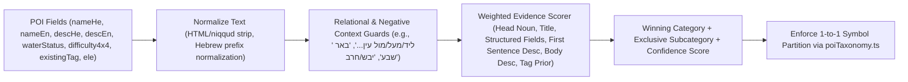

# NavApp — POI Refactoring Product Requirements Documents (PRDs)

This document defines the product requirements for refactoring NavApp's Points of Interest (POI) ecosystem across Web, PWA/Capacitor Mobile, Offline Search, Cloud Sync, and Android Auto.

> [!IMPORTANT]
> **Hard Architectural Invariant (Strict 1-to-1 Symbol Partition):** Every symbol ID, map sprite, and subcategory MUST belong to **exactly one** of the 6 existing POI categories (`water`, `offroad`, `campsite`, `heritage`, `peak`, `user`). Zero cross-category symbol sharing or fallback leakage is permitted.

---

## PRD-1: Strict 6-Category Taxonomy & Modern Symbol System

### 1.1 Problem Statement
Currently, NavApp's POI visual language suffers from four fragmentation and legibility issues:
1. **Legacy 1-bit/mixed map sprites:** MapLibre renders POIs from [public/assets/sprites/sprite.json](../public/assets/sprites/sprite.json) (legacy IHM raster glyphs) mixed with 3 tiny 24×24 procedural canvas icons (`offroad-pass`, `offroad-blocked`, `offroad-danger`) created in [src/App.tsx](../src/App.tsx) and duplicated in [CarMapController.java](../android/app/src/main/java/com/navapp/outdoor/israel/car/CarMapController.java).
2. **Cross-category symbol leakage:** `poiIconExpression` in [src/App.tsx](../src/App.tsx) falls back globally to `'viewpoint'` (a `heritage` icon) for unknown subcategories and shares generic icons such as `'dot'`/`'star'` without strict category ownership checks.
3. **Inconsistent UI emojis:** React components ([themeTokens.ts](../src/components/ui/themeTokens.ts), [LayerSwitcherSheet.tsx](../src/components/map/LayerSwitcherSheet.tsx), [AddPoiPanel.tsx](../src/components/pois/AddPoiPanel.tsx), [PoiInspectorSheet.tsx](../src/components/pois/PoiInspectorSheet.tsx)) render raw OS emojis (`💧`, `🚙`, `⛺`, `🏛️`, `🏔️`, `📍`) that vary wildly across Windows, Android, iOS, and Chromium.
4. **Low contrast on outdoor themes:** Flat single-color glyphs lose legibility over satellite imagery, dark topo mode, and sunlit desert hillshade.

### 1.2 Goals & Scope
- Keep the **exact 6 top-level categories** (`water`, `offroad`, `campsite`, `heritage`, `peak`, `user`) so existing visibility toggles (`poiWater`, `poiOffroad`, `poiCampsites`, `poiHeritage`, `poiPeaks`, `poiUser`), user preferences, and map layer filters remain compatible.
- Introduce a single canonical TypeScript registry (`src/core/pois/poiTaxonomy.ts`) as the **only** source of truth for:
  - Category metadata (Hebrew/English labels, colors, silhouette shape, sort priority).
  - Exclusive symbol IDs (`poi-<category>-<slug>`), each bound to strictly one `PoiCategory`.
  - Mapping from every canonical `subcategory` string to its exclusive symbol ID (with per-category exclusive fallback—never a global fallback).
- Design a **modern, high-DPI, outdoor-contrast cartographic symbol set** generated from a single SVG source bank into:
  - Web & Capacitor `@1x` (36×36px) + `@2x` (72×72px) MapLibre sprite atlas entries (`poi-*`).
  - Inline React SVG components (`<PoiCategoryIcon />`) replacing OS emojis across all UI panels.
  - Android Auto PNG/vector drawables / MapLibre Native sprite assets so Car Screen and Phone Screen match 100%.

### 1.3 Strict 1-to-1 Category & Symbol Matrix (31 Exclusive Symbols)

Every symbol uses a distinct **category outer silhouette + color family** so categories are distinguishable even at small zoom levels or for color-vision deficiency:

| Category | Layer Toggle & Accent Color | Outer Badge Shape | Exclusive Symbol ID | Meaning & Exclusive Subcategories | Default? |
| :--- | :--- | :--- | :--- | :--- | :---: |
| **`water`** (מים ומעיינות) | `poiWater` · Sky Blue `#0284C7` | Circle Teardrop Badge | `poi-water-spring` | מעיין / נביעה (`spring`, `water`) | **Yes** |
| | | | `poi-water-pool` | גב מים / בריכת שכשוך (`water_hole`, `water_pool`, `stream_pool`) | |
| | | | `poi-water-waterfall` | מפל (`waterfall`) | |
| | | | `poi-water-cistern` | בור מים / מאגורה / באר (`cistern`, `water_well`, `well`) | |
| | | | `poi-water-tap` | ברז מי שתייה (`tap`, `drinking_water`, `fountain`) | |
| **`offroad`** (מעלות ועבירות 4x4) | `poiOffroad` · Vivid Crimson/Orange `#DC2626` | Diamond / Shield Badge | `poi-offroad-pass` | מעלה / מעבר הרים / דיונה (`maale`, `mountain_pass`, `pass`, `sand_dune`) | **Yes** |
| | | | `poi-offroad-blocked` | שער סגור / דרך חסומה (`blocked`, `gate_closed`, `gate`, `barrier`) | |
| | | | `poi-offroad-danger` | סכנה / מדרגת סלע / הצלבה (`hazard`, `danger`, `rock_step`, `ford`) | |
| | | | `poi-offroad-mud` | בוץ / שקיעה / הצפה (`mud`, `wadi_crossing`) | |
| | | | `poi-offroad-track` | ציר 4x4 / נקודת עבירות קהילתית (`offroad_track`, `scenic_4x4`, `parking_4x4`) | |
| | | | `poi-offroad-service` | דלק שטח / פנצ'רייה / חילוץ (`fuel_4x4`, `recovery_service`) | |
| **`campsite`** (חניונים ולינה) | `poiCampsites` · Emerald Green `#059669` | Rounded Square Badge | `poi-campsite-night` | חניון לילה / קמפינג (`camp_site`, `campsite`, `night_camp`) | **Yes** |
| | | | `poi-campsite-picnic` | חניון יום / פיקניק / צל (`picnic_site`, `picnic`, `shade_grove`) | |
| | | | `poi-campsite-khan` | חאן / בקתה / מחסה (`khan`, `alpine_hut`, `shelter`) | |
| | | | `poi-campsite-fire` | פינת קפה / מדורה / עצירת דרך (`coffee_spot`, `rest_stop`, `bonfire`) | |
| **`heritage`** (מורשת, טבע ותצפיות) | `poiHeritage` · Warm Amber `#D97706` | Octagonal Crest Badge | `poi-heritage-landmark` | אתר מורשת / נקודת עניין כללית (`heritage_site`, `info`, `museum`) | **Yes** |
| | | | `poi-heritage-ruins` | חורבה / עתיקות / מצודה (`ruins`, `archaeological_site`, `castle`, `fort`) | |
| | | | `poi-heritage-cave` | מערה (`cave_entrance`, `cave`) | |
| | | | `poi-heritage-viewpoint` | תצפית נוף / מצפור (`viewpoint`, `scenic_view`) | |
| | | | `poi-heritage-monument` | אנדרטה / מצבה / אתר זיכרון (`monument`, `memorial`, `tomb`) | |
| | | | `poi-heritage-nature` | פריחה / עץ עתיק / גאולוגיה (`flowers`, `ancient_tree`, `geology`, `botany`) | |
| | | | `poi-heritage-holy` | בית כנסת / מנזר / מסגד / אתר קדוש (`holy_site`, `synagogue`, `monastery`) | |
| **`peak`** (פסגות והרים) | `poiPeaks` · Slate Indigo `#4F46E5` | Triangle / Crest Badge | `poi-peak-summit` | פסגה / הר / גבעה (`peak`, `summit`, `hill`) | **Yes** |
| | | | `poi-peak-saddle` | אוכף / שלוחה / מצוק (`saddle`, `ridge`, `cliff`) | |
| | | | `poi-peak-crater` | תל געשי / מכתש / לוע (`crater`, `volcano`, `tel_ridge`) | |
| | | | `poi-peak-tower` | מגדל תצפית פסגה / משואה (`fire_lookout`, `beacon`, `tower_peak`) | |
| **`user`** (נקודות משתמש ושירות) | `poiUser` · Royal Violet `#7C3AED` | Pin / Circle-Star Badge | `poi-user-pin` | נקודה אישית כללית (`user`, `custom_pin`, `poi`) | **Yes** |
| | | | `poi-user-flag` | יעד / נקודת ציון מסומנת (`waypoint`, `flag`, `target`) | |
| | | | `poi-user-note` | דיווח שטח / הערת משתמש (`field_note`, `report`) | |
| | | | `poi-user-star` | מועדף / מומלץ אישית (`favorite`, `star`) | |
| | | | `poi-user-service` | שירותים אזרחיים / רפואה / מזון (`civic_amenity`, `hospital`, `restaurant`, `shop`) | |

### 1.4 Functional & Non-Functional Requirements
- **REQ-1.1 (Zero Cross-Category Guarantee):** `poiTaxonomy.ts` MUST expose `resolvePoiSymbolId(category, subcategory)` such that the returned symbol ID always satisfies `SYMBOL_REGISTRY[symbolId].category === category`. If a POI's `subcategory` does not belong to `poi.category` (e.g., after a user edits the category without changing text), it MUST coerce to `CATEGORY_META[poi.category].defaultSubcategory` / `defaultSymbolId`.
- **REQ-1.2 (Modern Crisp Visual Styling):** Every symbol renders inside a vector badge with a `2px` high-contrast outer ring (white ring for dark/satellite legibility, subtle shadow halo) and crisp minimal inner white/accent iconography, avoiding messy raster scaling.
- **REQ-1.3 (Unified Asset Generation Pipeline):** A build script (`devops/generate-poi-symbols.mjs`) compiles all 31 SVGs into:
  - Updated `public/assets/sprites/sprite.{json,png}` and `sprite@2x.{json,png}` (preserving non-POI road/trail/shield base sprites).
  - Standalone React icon lookup (`src/components/pois/PoiCategoryIcon.tsx`).
  - Android Auto bitmap/drawable inputs so [CarMapController.java](../android/app/src/main/java/com/navapp/outdoor/israel/car/CarMapController.java) does not drift out of sync with the web app.
- **REQ-1.4 (UI Emoji Replacement):** All interactive POI controls ([LayerSwitcherSheet.tsx](../src/components/map/LayerSwitcherSheet.tsx), [AddPoiPanel.tsx](../src/components/pois/AddPoiPanel.tsx), [PoiInspectorSheet.tsx](../src/components/pois/PoiInspectorSheet.tsx), [SearchBar.tsx](../src/components/search/SearchBar.tsx), [App.tsx](../src/App.tsx) nearby cards, [ElevationProfileDrawer.tsx](../src/components/navigation/ElevationProfileDrawer.tsx)) render `<PoiCategoryIcon />` instead of raw emojis.
- **REQ-1.5 (Automated Invariant Test):** Unit tests MUST fail the build if any symbol ID, alias, or `subcategory` maps to more than one `PoiCategory`.

---

## PRD-2: Text-Integrated POI Recategorization Engine & Dataset Migration

### 2.1 Problem Statement
Inspection of the bundled datasets reveals significant misclassification caused by title-only regex heuristics and broad fallback buckets:
- [Israel.offroad.pois.geojson](../data/Israel.offroad.pois.geojson) (**62,233 POIs**): **18,991 POIs (~30.5%)** sit in generic `heritage:offroad_poi` (12,912) and `heritage:offroad_photo` (6,079), even though thousands explicitly describe springs, cisterns, night campsites, 4x4 rock steps/mud hazards, caves, viewpoints, or peaks inside `descHe` / `nameHe`.
- [Israel.pois.geojson](../data/Israel.pois.geojson) (**6,732 POIs**): Contains misclassified OSM/Wikipedia entries (e.g., `archaeological_site` items whose text explicitly states a water cistern/well like `"באר שמע"`, `viewpoint` entries whose text describes a memorial or picnic grove, or `peak` entries like `"מצפה שלגים"` that function as viewpoints or towers).
- `classifyByKeywords()` in [convert-offroad-pois.mjs](../devops/convert-offroad-pois.mjs) largely ignores `descHe` outside two narrow regex checks, while [CommunityPoiImporter.ts](../src/core/pois/CommunityPoiImporter.ts) uses an even simpler 5-line keyword check that ignores descriptions completely.

### 2.2 Goals & Scope
1. Build a unified, deterministic, **text-integrated classifier** (`src/core/pois/poiClassifier.ts`) shared identically by offline data scripts and runtime GPX/KML/GeoJSON/TWL imports.
2. Eliminate the legacy generic `offroad_poi` and `offroad_photo` catch-all subcategories by reclassifying every POI into its true category and exclusive subcategory using integrated signal analysis across **all text & metadata fields**.
3. Re-process both [Israel.offroad.pois.geojson](../data/Israel.offroad.pois.geojson) and [Israel.pois.geojson](../data/Israel.pois.geojson) (syncing `data/` and `public/data/`), produce a verifiable migration audit report, and embed the classifier in [fetch-israel-pois.mjs](../devops/fetch-israel-pois.mjs) and [convert-offroad-pois.mjs](../devops/convert-offroad-pois.mjs).

### 2.3 Text-Integrated Classification Design

Naive substring matching on `descHe` introduces false positives (e.g., *"תצפית מדהימה מעל עין עקב"* mentions a spring `"עין עקב"`, yet the POI itself is a **viewpoint**, not a spring). Therefore, the classifier uses **Weighted Field & Contextual Role Scoring**:



#### Scoring Weights & Contextual Rules
1. **Structured Domain Fields (Strongest Signal, `+100` to `+120`):**
   - Non-empty `waterStatus` with active water indicators (`מלא`, `זורם`, `רחצה`, `שכשוכית`) → `water`. (Note: `"יבש"` alone does NOT force `water` if structural tags point to `heritage:ruins`, unless title is clearly a spring/cistern/well).
   - Non-empty `difficulty4x4` or explicit trail pass cues (`הילוך כוח`, `נעילת דיפרנציאל`, `מדרגת סלע`, `הצלבות`, `עבירות קשה`) → `offroad`.
2. **Title Head-Noun Dominance (`+85`):**
   - The leading noun phrase in `nameHe` / `nameEn` carries the primary ontological identity (`"תצפית..."` → `heritage:viewpoint`, `"מצפור..."` → `heritage:viewpoint`, `"עין..."` / `"מעיין..."` / `"נביעת..."` / `"גב..."` / `"בור..."` → `water`, `"מעלה..."` / `"שער..."` / `"מחסום..."` → `offroad`, `"חניון לילה..."` → `campsite:night_camp`, `"חניון..."` → `campsite`, `"הר..."` / `"פסגת..."` / `"גבעת..."` → `peak`, `"אנדרטת..."` / `"מצבת..."` → `heritage:monument`, `"חורבת..."` / `"מערת..."` → `heritage:ruins`/`cave`).
3. **Title Secondary Keywords (`+55`):**
   - Full match anywhere in `nameHe` / `nameEn`, gated by municipal/settlement exclusion lists (`באר שבע`, `מעלה אדומים`, `מעלה אפרים`, `ראש העין`, `עין כרם` unless qualified by spring/trail noun).
4. **Description Text (`descHe` + `descEn`) Integration (`+45` first sentence / predicate, `+25` body):**
   - **Prepositional/Relational Dampener (`0.2×` weight):** Nouns immediately preceded by relational prepositions (`מעל `, `מול `, `לכיוון `, `משקיף על `, `סמוך ל`, `ליד `, `בדרך ל`, `קרוב ל`, `מדרום ל`, `מצפון ל`) are down-weighted by 80% so `"תצפית אל עין..."` or `"חניון לילה סמוך לבור מים"` stays `viewpoint` or `campsite`.
   - **Subject-Predicate Boost (`+60`):** Explicit identity sentences (`"מעיין הנובע...", "בור מים עתיק...", "מדרגה תלולה...", "חניון לילה מוסדר...", "שער ברזל נעול...", "תצפית פנורמית ל..."`) promote the subject category cleanly.
   - **Disambiguating Generic Buckets (`offroad_poi` / `offroad_photo`):** Items formerly lacking a specific subcategory rely heavily on `descHe` + `nameHe`:
     - Water cues in text (`מעיין`, `גב`, `בריכת מים`, `שכשוכית`, `מפל`, `ברז מים`, `נובע`) → `water:*`.
     - Camp/picnic cues (`חניון`, `לינת שטח`, `ספסלים`, `צל`, `שולחנות`, `מדורה`, `קמפינג`, `קפה`) → `campsite:*`.
     - Offroad/hazard cues (`חסום`, `שער`, `בולדרים`, `שיפוע צד`, `שקיעה`, `בוץ`, `מעלה`, `עבירות`, `4X4`, `דרגת קושי`) → `offroad:*`.
     - View/Heritage/Cave/Monument/Flora cues (`תצפית`, `נוף`, `חורבה`, `תל`, `מערה`, `אנדרטה`, `שלט הסבר`, `פריחה`) → `heritage:*`.
     - Elevation/Peak cues (`פסגה`, `אוכף`, `שלוחה`, `הר`, `גבעה` without viewpoint/picnic override) → `peak:*`.
     - Remaining 4x4 community track waypoints with vehicle-route context → `offroad:offroad_track`; general landmark points without 4x4 context → `heritage:heritage_site`.
5. **Tie-Breaking & Confidence Metadata:**
   - Deterministic category priority order for exact ties based on existing OSM/IHM semantic tag prior (`+18`), preventing churn on valid OSM nodes.
   - Every output `subcategory` is guaranteed valid for the winning `category` via `poiTaxonomy.ts`.

### 2.4 Acceptance Criteria
- **Zero legacy `offroad_poi` or `offroad_photo` subcategories** remain in `data/Israel.pois.geojson` or `data/Israel.offroad.pois.geojson`.
- **Zero invalid `(category, subcategory)` pairs** across all ~69,000 POIs.
- Migration dry-run report generated and verified against curated benchmark test cases covering tricky Hebrew outdoor descriptions (springs near viewpoints, dry ruins vs active cisterns, blocked gates, night vs day camps, 4x4 rock steps, and municipal false positives).
- `CommunityPoiImporter.ts` produces identical classification for imported `.gpx`/`.kml`/`.geojson`/`.twl` waypoints.

---

## PRD-3: POI Deletion & Category Reassignment Lifecycle

### 3.1 Problem Statement
Users currently have no way to curate the map when a POI is permanently gone/closed (e.g., dried-up tap, removed landmark, duplicate pin) or placed in the wrong category:
1. [PoiInspectorSheet.tsx](../src/components/pois/PoiInspectorSheet.tsx) only supports editing `userNotes`. It has no Delete action and no Category/Symbol selector.
2. [PoiManager.ts](../src/core/pois/PoiManager.ts) reloads `Israel.pois.geojson` and `Israel.offroad.pois.geojson` on every startup. Any direct deletion or property edit inside `db.pois` (or in-memory `offroadPoisCache`) would be **silently reverted** on the next app restart or bundled map update.
3. [PMTilesSearchService.ts](../src/core/search/PMTilesSearchService.ts), [ElevationProfileDrawer.tsx](../src/components/navigation/ElevationProfileDrawer.tsx), [UserStateSyncService.ts](../src/core/preferences/UserStateSyncService.ts), and [CarSyncService.ts](../src/core/car/CarSyncService.ts) do not account for deleted bundled POIs or user-overridden categories.

### 3.2 Goals & Scope
- Enable any user (online or 100% offline) to **change the category (and exclusive symbol)** or **delete** any POI (`user-poi-*`, `import-*`, `osm-*`, `il-poi-*`, `or-*`).
- Persist all deletions (tombstones) and category edits permanently across restarts, bundled dataset updates, Search results, and Android Auto.
- Provide safe accidental-delete protection (inline two-step confirmation + Undo toast).

### 3.3 User Experience & Flows

#### Flow A: Change Category (and Symbol)
1. User taps any POI on the map, Nearby list, or Search results to open `PoiInspectorSheet`.
   - Note: In Mobile Navigating Mode (`compactNavigating`), tapping `"פרטים"` transitions to the full inspector where editing is available safely without cluttering driving UI.
2. In the Inspector header, the category badge pill renders with a subtle edit affordance (`"שנה קטגוריה"` button / tappable pill).
3. Tapping it expands an inline **Category & Symbol Picker**:
   - Row 1: The 6 categories (`water`, `offroad`, `campsite`, `heritage`, `peak`, `user`) shown with modern `<PoiCategoryIcon />` icons and category color highlights.
   - Row 2: Exclusive symbols belonging strictly to the selected category (so the user can e.g. switch a POI from `heritage:heritage_site` → `water:water_hole` or `water:cistern`).
   - Optional `"איפוס לברירת מחדל"` link appears when a bundled POI currently has a user override.
4. Selecting confirms immediately (or via single tap on symbol chip) -> calls `PoiManager.updatePoiCategory(poi, nextCategory, nextSubcategory)`:
   - MapLibre symbol icon, label text color, category filter behavior, and inspector badge update instantaneously.
   - Confirmation toast shown (`"עודכן לקטגוריית <label>"`).

#### Flow B: Delete POI
1. At the bottom/header action area of `PoiInspectorSheet`, a subtle destructive `"מחק נקודה"` button is shown.
2. Clicking `"מחק נקודה"` reveals an **inline confirmation bar** (`"למחוק נקודה זו לצמיתות מהמפה?"` with `[אשר מחיקה]` / `[ביטול]`)—never `window.confirm()`.
3. Confirming calls `PoiManager.deletePoi(poi)`:
   - **For custom/imported POIs (`user-poi-*`, `import-*`):** Deleted from `db.pois` (with previous record kept in short-lived memory for Undo).
   - **For bundled POIs (`osm-*`, `il-poi-*`, `or-*`):** Records `{ id, deleted: true, updatedAt }` in Dexie `poiOverrides` table (and removes from `db.pois` / filters out of `offroadPoisCache`), so future startups never resurrect the POI.
   - Inspector closes, `pois` React state updates immediately, MapLibre `israel-pois-src` refreshes, and if `selectedPoi` was active it clears.
   - **Undo Toast (6 seconds):** `"הנקודה נמחקה • [בטל מחיקה]"`. Tapping Undo restores the record / removes the tombstone immediately.

#### Flow C: Add Custom POI (`AddPoiPanel`)
- `AddPoiPanel` allows choosing one of the 6 categories (rendered with modern `<PoiCategoryIcon />`) AND optionally picking one of that category's exclusive subcategories/symbols before saving.

### 3.4 Data Persistence & Cross-Platform Parity
- **IndexedDB Schema (`NavDatabase` Dexie `version(5)`):**
  - New table `poiOverrides: 'id, deleted, category, updatedAt'` storing:
    ```ts
    export interface PoiOverrideRecord {
      id: string;
      deleted?: boolean;
      category?: PoiCategory;
      subcategory?: string;
      updatedAt: string;
    }
    ```
  - Migration from `v4` to `v5` preserves all existing tables cleanly with zero data loss.
- **Search Integration (`PMTilesSearchService`):**
  - Curated POI search naturally uses live `pois` (so deleted POIs vanish and recategorized POIs match their updated `poiCategory`/`filterGroup`).
  - Pass deleted POI coordinate/name tombstones so matching duplicate `pmtiles` entries within `85m` and matching normalized title are also suppressed if the user deleted that POI.
- **Cloud Sync (`UserStateSyncService`):**
  - Optionally sync compact `poiOverrides` map in user cloud state (bounded cleanly to prevent oversized Firestore writes) so signed-in users retain deletions/reclassifications across devices.
- **Android Auto (`CarSyncService.ts` + `NativeMapStore.java`):**
  - Extend `buildCarSyncPayload` to include `deletedPoiIdsJson` alongside `userPoisJson` (which must include **any bundled POI with a category/subcategory override**, not only `userNotes`).
  - Update `NativeMapStore.java` to filter out `deletedPoiIds` and overlay category/subcategory overrides when building `compact_pois.geojson` for the car display.

### 3.5 Acceptance Criteria
- Deleting any bundled (`osm-*`, `il-poi-*`, `or-*`) or user/imported (`user-poi-*`, `import-*`) POI removes it immediately from map, search, and nearby list, and **stays deleted after full browser reload / Capacitor app restart**.
- Changing the category/symbol of any POI updates its map sprite, text color, layer toggle visibility (`poiWater`, etc.), search filter, and Android Auto payload immediately, and **persists across restarts**.
- Undo within toast window cleanly restores the POI (including previous category/notes).
