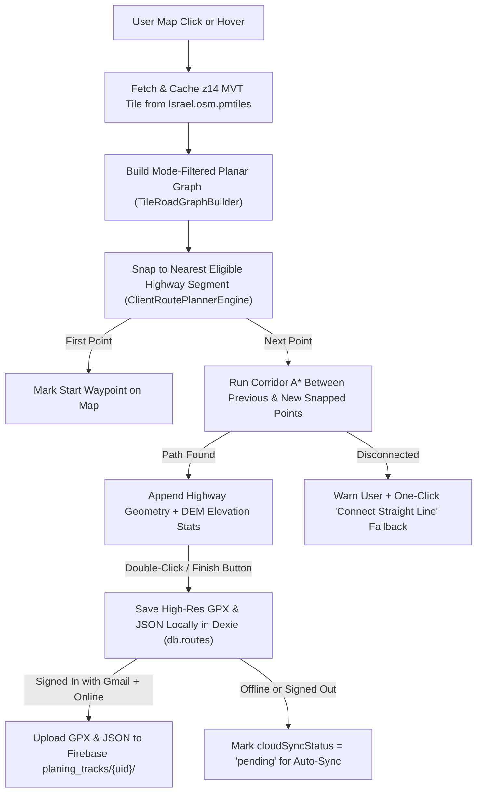

# Route Planning Implementation Plan (Client-Side Network Routing + Firebase `planing_tracks`)

## Goal
Build a 100% client-side route planning capability inside **NavApp** supporting **4x4 Vehicle**, **Foot**, and **Bicycle** modes. Users click on the map to snap waypoints onto the nearest routable highway/trail segment inside `Israel.osm.pmtiles`, automatically connect consecutive points along the mode-specific highway network, finish on double-click (at the existing last point, plus a mobile Finish button), and save the resulting route both **locally (IndexedDB / GPX)** and **per Gmail user in Firebase (`planing_tracks/{uid}/`)**.

---

## Architecture Overview

Because NavApp already hosts full-detail vector map data inside `Israel.osm.pmtiles` (OpenMapTiles `transportation` layer, z4–z14) and terrain elevations inside `Israel.dem.pmtiles`, snapping and routing run **100% client-side and offline** without external routing APIs (no OSRM/GraphHopper backend needed).

> [!IMPORTANT]
> **Why decode `Israel.osm.pmtiles` directly instead of `map.queryRenderedFeatures()`?**
> `map.queryRenderedFeatures()` only inspects currently rendered screen layers and misses trails/minor roads when zoomed out below z12–z13 or when visual layers are toggled off. Decoding zoom-14 tiles directly from `pmtilesRegistry.getArchive('israel-osm')` gives full-resolution geometry and all OSM routing attributes (`class`, `subclass`, `tracktype`, `oneway`, `access`, `foot`, `bicycle`, `motor_vehicle`, `layer`, `brunnel`) at any map zoom level.

---

## Key Design Decisions & Prerequisites

### 1. Firebase Per-User Storage & Gmail Authentication (`planing_tracks`)
Because [firebase.json](../firebase.json) configures static **Firebase Hosting** (`navapp-israel-topo` and `navapp-israel-topo-data`), browser clients cannot write files into Firebase Hosting folders at runtime. Per-user cloud persistence uses:
1. **Firebase Authentication (Google / Gmail Sign-In)**: Identifies each user by `uid` and `email` via `GoogleAuthProvider`.
2. **Firebase Cloud Storage (`planing_tracks/{uid}/{routeId}.gpx` + `{routeId}.json`) & Cloud Firestore (`planing_tracks/{uid}/routes/{routeId}`)**:
   - Uploads the high-resolution `.gpx` file + companion `.json` payload into `planing_tracks/<uid>/` in Cloud Storage (when Storage bucket is initialized) AND stores the route metadata, serialized GeoJSON (`geojsonJson`), and `gpxXml` under `planing_tracks/{uid}/routes/{routeId}` in Cloud Firestore (`me-west1` Tel Aviv).
   - Security rules (`firestore.rules` and `storage.rules`) enforce per-user isolation: `request.auth != null && request.auth.uid == userId`.
   - **Spark vs. Blaze Plan Fallback**: If Cloud Storage has not been initialized on the Firebase project yet, Firestore persistence (`planing_tracks/{uid}/routes/{routeId}`) succeeds immediately on the free Spark tier and syncs across sessions/devices.
   - **Capacitor Mobile Note**: On Web/PWA, `signInWithPopup` (with `signInWithRedirect` fallback) works natively. Inside Capacitor Android/iOS WebViews, native builds can add system-browser OAuth or `@capacitor-firebase/authentication`.

### 2. Mode Filtering Rules (`Israel.osm.pmtiles` Schema)
The `transportation` layer contains `LineString` (`type === 2`) and `Polygon` (`type === 3`) features with fields: `class`, `subclass`, `tracktype`, `smoothness`, `surface`, `sac_scale`, `mtb_scale`, `bicycle`, `foot`, `motor_vehicle`, `motorcar`, `access`, `oneway`, `layer`, `brunnel`, `barrier`.

| Mode | Included Classes / Subclasses | Excluded / Blocked | Directionality & Cost Bias |
| :--- | :--- | :--- | :--- |
| **4x4 Vehicle (`4x4`)** | `track` (all `tracktype` grades 1–5) + all motorable roads (`motorway`, `trunk`, `primary`, `secondary`, `tertiary`, `minor`, `service`) | `path` (`path`, `footway`, `cycleway`, `steps`, `pedestrian`, `platform`), `*_construction`, `pier`, `rail`; `motor_vehicle=no`, `motorcar=no`, `access=no` (unless `motor_vehicle=yes`) | Honors `oneway` (`1` / `-1`) on paved roads; `track` bidirectional; slight preference weighting for valid connecting roads without blocking highways |
| **Foot (`foot`)** | `path` (`path`, `footway`, `steps`, `pedestrian`, `platform` LineStrings; `cycleway` if `foot !== 'no'`), `track`, `minor`, `service`, `tertiary`, `secondary`, `primary` | `motorway`, `trunk` (unless `foot=yes`/`designated`), `*_construction`, `pier`, `rail`; `foot=no` or `access=no` (unless `foot=yes`) | Fully bidirectional (ignores vehicle `oneway`); favors trails/footpaths (`0.85x`) and tracks (`0.95x`) over busy `primary`/`secondary` roads (`1.65x–2.0x`) |
| **Bicycle (`bicycle`)** | `path` (`cycleway`, `path` when `bicycle !== 'no'`, `footway`/`pedestrian` only if `bicycle=yes`/`designated`/`permissive`, or `mtb_scale` present), `track`, `minor`, `service`, `tertiary`, `secondary`, `primary` | `steps`, `motorway`, `trunk` (unless `bicycle=yes`), `*_construction`, `pier`, `rail`; `bicycle=no` or `access=no` (unless `bicycle=yes`) | Honors `oneway` on paved roads (except cycleways/contraflow); tracks & paths bidirectional; favors `cycleway`/`mtb_scale`/`track` (`0.85x–0.95x`) over busy roads (`1.6x–2.0x`) |

### 3. Cross-Tile Topology & Mid-Segment Intersection Splitting
Inspection of `Israel.osm.pmtiles` z14 tiles (e.g., Ein Aqev & Jerusalem) shows:
1. Over half of road/trail intersections occur at **shared interior vertices** of OSM ways (not just endpoints).
2. Adjacent tiles share **exact global z14 integer coordinates** `(gx = tx * 4096 + pt.x, gy = ty * 4096 + pt.y)`.

Therefore, [`TileRoadGraphBuilder.ts`](../src/core/routing/TileRoadGraphBuilder.ts):
- Clips each decoded `LineString` cleanly to `[0, 4096] × [0, 4096]` to avoid duplicate edges across tile buffers.
- Snaps clipped tile-boundary intersections (`gx % 4096 === 0` or `gy % 4096 === 0`) within `<= 2` z14 units (~1m) so roads crossing tile boundaries stitch seamlessly.
- Splits polylines at **every vertex shared by >= 2 distinct routable features** while matching `layer` (`0`, `1`, `-1`, etc.) so bridges and tunnels do not falsely connect to roads passing underneath.

---

## Implemented Modules

### Phase 1: Core Routing Engine
- [`package.json`](../package.json): `firebase`, `@mapbox/vector-tile`, `pbf`.
- [`src/core/pmtiles/PMTilesRegistry.ts`](../src/core/pmtiles/PMTilesRegistry.ts): Pre-registers default `israel-osm` `PMTiles` archive during `initProtocols()` so `getArchive('israel-osm')` works immediately at startup.
- [`src/core/routing/RoutingProfiles.ts`](../src/core/routing/RoutingProfiles.ts): Defines `PlanningMode = '4x4' | 'foot' | 'bicycle'` and `evaluateEdgeAccess(props, mode)`.
- [`src/core/routing/TileRoadGraphBuilder.ts`](../src/core/routing/TileRoadGraphBuilder.ts): Fetches z14 MVT tiles via `PMTiles`, caches decoded tile datasets (LRU cache), clips geometries, splits interior junctions by `layer`, and stitches cross-tile seams.
- [`src/core/routing/ClientRoutePlannerEngine.ts`](../src/core/routing/ClientRoutePlannerEngine.ts): `snapToNearestHighway(...)` and `routeBetweenSnappedPoints(...)` using expanding z14 tile corridors and binary-heap A* with virtual mid-edge split nodes.

### Phase 2: Local Persistence, High-Res GPX & Firebase `planing_tracks`
- [`src/core/db/NavDatabase.ts`](../src/core/db/NavDatabase.ts): Dexie `version(2)` schema with `PlannedWaypoint` & cloud sync fields (`ownerUid`, `ownerEmail`, `cloudSyncStatus`, `gpxXml`, `planningMode`).
- [`src/core/navigation/RouteManager.ts`](../src/core/navigation/RouteManager.ts): `createAndSavePlannedRoute(...)` & high-resolution XML-escaped `exportRouteAsGpx(route)` with `<wpt>` waypoints and `<trkseg>` / `<trkpt>` DEM elevations.
- [`src/core/firebase/firebaseApp.ts`](../src/core/firebase/firebaseApp.ts): Initializes Firebase Auth, Firestore, and Cloud Storage from `VITE_FIREBASE_*` env vars.
- [`src/core/firebase/AuthService.ts`](../src/core/firebase/AuthService.ts): Google/Gmail sign-in/sign-out (`signInWithPopup` + `signInWithRedirect` fallback).
- [`src/core/firebase/PlannedTracksCloudService.ts`](../src/core/firebase/PlannedTracksCloudService.ts): Saves to Cloud Storage (`planing_tracks/{uid}/{routeId}.gpx` & `.json`) and Cloud Firestore (`planing_tracks/{uid}/routes/{routeId}`), syncs pending offline routes, and fetches remote planned routes.
- [`firestore.rules`](../firestore.rules), [`storage.rules`](../storage.rules), and [`public/sw.js`](../public/sw.js): Per-user rules and Firebase OAuth/API Service Worker bypass.

### Phase 3: Interactive Planning UI & Map Integration
- [`src/components/navigation/RoutePlannerPanel.tsx`](../src/components/navigation/RoutePlannerPanel.tsx): Mode selector (`4x4`, `foot`, `bicycle`), route name input, Google account sync card, live telemetry, disconnected-leg fallback prompt, undo/clear/finish controls.
- [`src/App.tsx`](../src/App.tsx) & [`src/components/navigation/ElevationProfileDrawer.tsx`](../src/components/navigation/ElevationProfileDrawer.tsx): Desktop & Mobile planner panels, MapLibre hover/click/double-click planning handlers, planning overlay sources/layers, and route deletion/sync lifecycle.

---

## Verification Plan

### Automated Tests (`Vitest`)
- [`src/core/__tests__/routePlanner.test.ts`](../src/core/__tests__/routePlanner.test.ts):
  - Tests `4x4`, `foot`, and `bicycle` access/oneway/cost rules.
  - Tests interior junction splitting, bridge layer isolation, cross-tile stitching, and disconnected detection.
  - Queries real z14 vector tiles from [`data/Israel.osm.pmtiles`](../data/Israel.osm.pmtiles) in Ein Aqev (`4x4` and `foot`) and Jerusalem (`bicycle`).
  - Tests high-res GPX 1.1 export, Firebase `planing_tracks` paths, and Firestore nested-array-free serialization.
