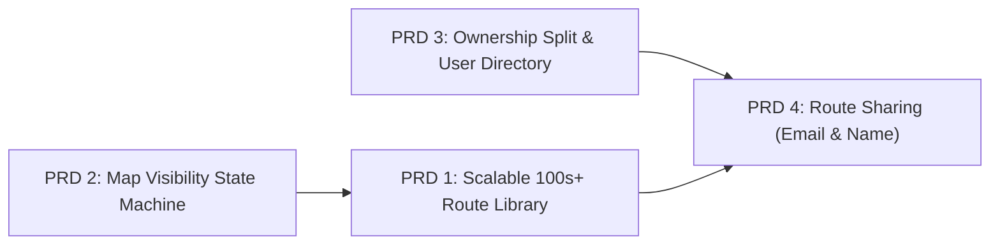

# NavApp — Route Planning v2 Implementation Plan (PRDs & Stories)

This implementation plan upgrades NavApp's route architecture to support **hundreds of planned/saved routes**, separates **"My Routes"** from **"Shared With Me"** with user-to-user sharing (by **Gmail email** or **in-app display name**), and enforces **deterministic map display rules** so the map never becomes cluttered.

## Confirmed Product Decisions
1. **Optional Background Reference Toggle (PRD 2)**: Strict idle cleanup applies by default (only display during planning, selecting in Routes drawer, editing, or navigating), plus an explicit optional `"השאר מסלול ברקע"` / reference toggle when comparing or planning near an existing route.
2. **Shared Route Permissions (PRD 3/4)**: Shared routes are read-only from the sender (view, navigate, export GPX, dismiss) with a one-click **"העתק למסלולים שלי"** (`Duplicate to My Routes`) action to create an editable personal copy.
3. **Firebase Rules & Indexes (PRD 3/4)**: Updated [firestore.rules](../firestore.rules) and any `collectionGroup` indexes will be included and deployed via Firebase.

---

## Architecture Dependency Map



> [!TIP]
> **PRD 2** (strict map visibility) can be implemented independently right now, or in parallel with **PRD 1** (scaling to 100s of routes) and **PRD 3** (User Directory + My/Shared data split). **PRD 4** (Sharing UI & live inbox) builds on **PRD 3**.

---

## PRD 1: Scalable Route Library & Performance (100s–1,000+ Routes)

### Problem Statement
Currently ([NavDatabase.ts](../src/core/db/NavDatabase.ts), [App.tsx](../src/App.tsx), [ElevationProfileDrawer.tsx](../src/components/navigation/ElevationProfileDrawer.tsx)), the app loads every saved route's full `geojson`, `elevationProfile`, and `gpxXml` into React state on startup, renders an unsearchable dropdown, and pushes all routes into MapLibre sources. With hundreds of routes, startup time, RAM usage, IndexedDB serialization, and selector usability degrade rapidly.

---

### Story 1.1: Split Route Summary Metadata from Heavy Geometry Store
**As a** user storing hundreds of routes,  
**I want** the app to load lightweight route summaries immediately and fetch heavy GeoJSON/GPX payloads on demand,  
**so that** startup, switching tabs, and scrolling stay instant even with 500+ routes.

- **Scope & Files**:
  - [NavDatabase.ts](../src/core/db/NavDatabase.ts) (`version(4)` schema)
  - [RouteManager.ts](../src/core/navigation/RouteManager.ts)
- **Technical Changes**:
  1. Introduce `RouteSummaryRecord` (id, name, sourceFormat, planningMode, ownership metadata, bounds `[minLon, minLat, maxLon, maxLat]`, `distanceKm`, `ascentMeters`, `descentMeters`, `minEle`, `maxEle`, `color`, `colorCustomized`, `cloudSyncStatus`, `updatedAt`, `createdAt`) vs. `routePayloads` table (or separate heavy store `[geojson, elevationProfile, gpxXml, waypoints]`) keyed by `routeId`.
  2. Add Dexie v4 migration that cleanly splits existing `db.routes` rows without data loss.
  3. Add `RouteManager.listRouteSummaries()` (instantaneous startup) and `RouteManager.loadFullRoute(routeId)` with a bounded in-memory LRU cache (e.g., last 10–15 active/edited/navigated routes).
- **Acceptance Criteria**:
  - App cold-starts with 500 synthetic routes in Dexie in under 300ms for metadata listing.
  - Exporting GPX, starting navigation, or opening `"ערוך נקודות"` transparently hydrates the full route via `loadFullRoute(id)`.
  - Zero regression to existing route tests.

---

### Story 1.2: Searchable, Filterable & Virtualized Route Picker UI
**As a** user with hundreds of planned routes,  
**I want** search, filters, sorting, and fast scrolling inside the Routes drawer,  
**so that** I can locate and select any route in seconds on mobile and desktop.

- **Scope & Files**:
  - [ElevationProfileDrawer.tsx](../src/components/navigation/ElevationProfileDrawer.tsx)
  - [PMTilesSearchService.ts](../src/core/search/PMTilesSearchService.ts) (route summary search integration)
- **Technical Changes**:
  1. Replace the flat `max-h-48` dropdown list with a dedicated **Route Picker** view/panel inside `ElevationProfileDrawer`:
     - Instant text search bar (`שם מסלול` / area / author name for shared routes).
     - Quick filter chips: `הכל`, `4x4`, `הליכה`, `אופניים`, `מיובא (GPX/KML)`.
     - Sort options: `עודכן לאחרונה`, `שם (א-ת)`, `מרחק (קצר/ארוך)`, `טיפוס`.
  2. Render windowed/paginated slices (e.g., initial 40 items + "טען עוד" / intersection observer) so scrolling 500 routes stays 60fps on mobile.
  3. Remove slow `"הכל"` full-map render default; show route count per filter tab cleanly (`המסלולים שלי (142)` / `שותפו איתי (28)`).
- **Acceptance Criteria**:
  - Searching by partial Hebrew/English route name filters 500 routes instantaneously (`<16ms`).
  - Both mobile (`390x844`) and desktop drawer layouts remain uncluttered with clean BiDi formatting.

---

### Story 1.3: Incremental Cloud Sync & Lazy Payload Hydration
**As a** user syncing hundreds of planned routes across devices,  
**I want** Firebase sync to fetch only updated/new route metadata and pull heavy GPX/GeoJSON lazily when opened,  
**so that** login and offline switches don't saturate Firestore/Storage bandwidth.

- **Scope & Files**:
  - [PlannedTracksCloudService.ts](../src/core/firebase/PlannedTracksCloudService.ts)
- **Technical Changes**:
  1. Add `syncWatermarkMs` per user in `localStorage` / user state, querying `where('updatedAt', '>', lastWatermark)` ordered by `updatedAt` (with fallback full reconciliation on first login).
  2. Split remote metadata/payload fetch cleanly or cache downloaded payloads in IndexedDB immediately so offline navigation works reliably once synced or opened.
  3. Add throttled batch uploads (`concurrency = 3`) for `syncPendingRoutesForUser` when dozens of routes were edited offline.
- **Acceptance Criteria**:
  - Opening the app while already signed in transfers 0 unchanged route documents after watermark sync.
  - Pending offline edits sync reliably in background without blocking the UI.

---

## PRD 2: Deterministic Map Route Display Rules

### Problem Statement
Currently ([App.tsx](../src/App.tsx#L1343)), every saved route with `visible !== false` renders on `saved-routes-src` at all times—even when browsing the empty map—and `active-route-src` lingers after closing the Routes drawer. With hundreds of routes, all-on map rendering causes severe visual clutter and GPU overhead.

### Desired Visibility Contract (Strict Rules)
A route is rendered on the map **if and only if** at least one of these 3 conditions is true:
- **(a) Planning / Selecting**: User is currently planning a route (`plan-route` drawer/overlay) **OR** actively viewing/selecting a route inside the Routes selector (`desktopDrawer === 'routes'` or mobile `routes` tab/sheet).
- **(b) Editing**: User is editing an existing route (`editingRouteId !== null` in `RoutePlannerPanel` or editing details while selected in Routes drawer).
- **(c) Navigating**: User has pressed **"התחל ניווט במסלול"** and route navigation is active (`isNavigatingRoute && activeRoute`).

When none of (a), (b), or (c) is active (e.g., user closes the Routes drawer, switches to Explore/Map tab, exits planning/editing, and stops navigation), **all route lines/endpoints are hidden from the map**.

---

### Story 2.1: Unified Route Map Display State Machine
**As a** navigator,  
**I want** routes to appear on the map only when planning, selecting, editing, or actively navigating,  
**so that** the topographic map stays completely clean during free exploration.

- **Scope & Files**:
  - [App.tsx](../src/App.tsx) (`syncOverlaySourcesToMap`, drawer/tab handlers, navigation lifecycle)
- **Technical Changes**:
  1. Replace always-on `saved-routes-src` rendering with an explicit derived selector `computeDisplayedMapRoutes(...)`:
     - **Navigating (`c`)**: show `activeRoute` (regardless of previous `visible` toggle; force-display during navigation).
     - **Planning / Editing (`a` / `b`)**: show `planOverlayState` interactive legs + numbered waypoints; suppress any duplicate static `active-route-src` for `editingRouteId`.
     - **Selecting (`a`)**: when desktop `desktopDrawer === 'routes'` or mobile (`mobileDisplayMode === 'planning' && mobileTab === 'routes' && mobileSheetExpanded`), show the currently selected route (`activeRoute`, unless explicitly muted during editing). Optional: allow a lightweight temporary "השוואה על המפה" state only while the drawer remains open.
     - **Idle (`none`)**: clear `saved-routes-src` and `active-route-src` and `active-route-endpoints-src` to empty FeatureCollections.
  2. Keep `"התחל ניווט במסלול"` explicit: clicking Start Navigation locks the route onto the map and transitions cleanly to navigation mode (closing planning/routes drawer on desktop/mobile while keeping the route visible until `"עצור ניווט"`).
- **Acceptance Criteria**:
  - Launching app with 100 stored routes shows **0 route overlays** on the idle map.
  - Opening `"מסלולים"` and selecting a route displays **only that route** and flies to it; closing `"מסלולים"` removes it from the map.
  - Opening `"תכנון מסלול"` or clicking `"ערוך נקודות"` renders the draft/edited route; saving or canceling clears the planner overlay cleanly (and only stays visible if transitioning into the `"מסלולים"` drawer with that route selected or starting navigation).
  - Pressing `"התחל ניווט במסלול"` keeps the route visible even when switching tabs or minimizing sheets, and hides it cleanly when `"עצור ניווט"` is clicked.

---

### Story 2.2: Clarify Route Visibility UX in Drawer & Actions
**As a** user browsing the Routes drawer,  
**I want** clear visual feedback showing when a route is currently displayed vs. map-cleared on drawer close,  
**so that** the new behavior feels intentional and predictable.

- **Scope & Files**:
  - [ElevationProfileDrawer.tsx](../src/components/navigation/ElevationProfileDrawer.tsx)
  - [App.tsx](../src/App.tsx)
- **Technical Changes**:
  1. Remove/repurpose the confusing per-route persistent Eye (`visible`) toggle from driving an always-on clutter layer; replace with context-accurate states:
     - Status pill in drawer header when browsing: `"מוצג במפה כעת (במצב בחירה / עריכה / ניווט)"`
     - `"התמקד במפה"` (`הצג`) centers the map on the currently previewed route while drawer is open.
     - Closing the drawer on desktop (`X`) or switching mobile bottom tab away from `מסלולים` smoothly clears the map preview without losing which route was last inspected in the list.
  2. When in Planning mode (`תכנון מסלול`), add optional toggle `"הצג מסלול ייחוס ברקע"` if a user explicitly wants to trace near an existing route during planning (defaults to OFF).
- **Acceptance Criteria**:
  - Zero orphaned Eye/EyeOff warnings (`"המסלול מוסתר כרגע"`) blocking navigation—pressing `"התחל ניווט במסלול"` always displays the selected route immediately.

---

## PRD 3: Ownership Split ("My Routes" vs. "Shared With Me") & User Directory

### Problem Statement
All routes currently live in a single flat list with no clear distinction between routes created/imported by the user and routes received from others, and there is no Firestore user profile registry for resolving users by **Gmail address** or **app display name**.

---

### Story 3.1: Firestore User Directory & Profile Sync (`/users/{uid}`)
**As a** signed-in app user,  
**I want** my Google account profile (UID, Gmail email, display name, photo) registered in Firestore on login,  
**so that** friends can find and share routes with me by my Gmail address or my in-app name.

- **Scope & Files**:
  - `src/core/firebase/UserDirectoryService.ts` *(new)*
  - [AuthService.ts](../src/core/firebase/AuthService.ts)
  - [firestore.rules](../firestore.rules)
  - [App.tsx](../src/App.tsx)
- **Technical Changes**:
  1. On sign-in / auth restore, write/merge `/users/{uid}`:
     ```ts
     {
       uid: string,
       email: string,            // original case
       emailLower: string,       // lowercase for exact matching
       displayName: string,
       displayNameLower: string, // lowercase for prefix search
       photoURL: string | null,
       lastSeenAt: string
     }
     ```
  2. Add Firestore security rules for `/users/{userId}`:
     - `allow read: if request.auth != null;` (needed for recipient search by authenticated users)
     - `allow write: if request.auth != null && request.auth.uid == userId;`
  3. Implement `UserDirectoryService.searchUsers(queryText)`:
     - If query contains `@`: exact lookup on `emailLower` + fallback invite option even if user hasn't opened NavApp yet.
     - Otherwise: Firestore prefix range query on `displayNameLower` (`>= q && <= q + '\uf8ff'`, limit 10) returning `{ uid, displayName, email, photoURL }`.
- **Acceptance Criteria**:
  - Logging in automatically registers/updates the user's `/users/{uid}` record.
  - Querying by `"ohad"` or `"ohad@gmail.com"` returns matching signed-in users with name, avatar, and email disambiguation.

---

### Story 3.2: Separate "My Routes" vs. "Shared With Me" Model & Read-Only Protection
**As a** user receiving routes from others,  
**I want** routes clearly separated into **My Routes** (`המסלולים שלי`) and **Shared With Me** (`שותפו איתי`),  
**so that** I know who created each route and cannot accidentally overwrite someone else's original track.

- **Scope & Files**:
  - [NavDatabase.ts](../src/core/db/NavDatabase.ts)
  - [RouteManager.ts](../src/core/navigation/RouteManager.ts)
  - [ElevationProfileDrawer.tsx](../src/components/navigation/ElevationProfileDrawer.tsx)
- **Technical Changes**:
  1. Add ownership & sharing fields to `SavedRouteRecord`:
     - `ownership: 'mine' | 'shared'` (default `'mine'` for existing/created/imported routes)
     - `ownerDisplayName?: string | null`
     - `sharedByUid?: string | null`
     - `sharedByName?: string | null`
     - `sharedByEmail?: string | null`
     - `sharedWith?: Array<{ uid?: string | null; email: string; displayName?: string | null; sharedAt: string }>`
     - `sharedWithUids?: string[]`
     - `sharedWithEmails?: string[]`
  2. Add segmented tabs at top of the Routes drawer (`ElevationProfileDrawer`):
     - Tab 1: **`המסלולים שלי (N)`** — full edit permissions (rename, color, reverse, edit waypoints, share, delete).
     - Tab 2: **`שותפו איתי (M)`** — shows sender attribution badge (`"שותף ע״י: <שם / אימייל>"`), supports selecting/viewing on map, elevation scrubbing, GPX export, starting navigation, hiding/dismissing from inbox, and **"שמור עותק אצלי"** (clones into `המסלולים שלי` as an editable copy with `'mine'` ownership).
- **Acceptance Criteria**:
  - Existing local/planned/imported routes stay in `המסלולים שלי` cleanly after upgrade.
  - Shared routes never expose destructive rename/waypoint-edit of the original owner's route; instead offer a one-click **"העתק למסלולים שלי"**.

---

## PRD 4: User-to-User Route Sharing (Gmail Email & App Display Name)

### Problem Statement
Currently routes are isolated per UID in `/planing_tracks/{userId}/routes/{routeId}` and cannot be shared with other app users.

---

### Story 4.1: Multi-User Share Rules & Pending Email Claim Architecture
**As a** system,  
**I want** Firestore rules and data queries to securely authorize only the route owner and explicitly shared recipients,  
**so that** shared routes are private between sender and recipients and work even if the recipient signs in after the share was sent.

- **Scope & Files**:
  - [firestore.rules](../firestore.rules)
  - `firestore.indexes.json` *(new if needed for `collectionGroup` + `array-contains`)*
  - [PlannedTracksCloudService.ts](../src/core/firebase/PlannedTracksCloudService.ts)
- **Technical Changes**:
  1. Update `/planing_tracks/{userId}/routes/{routeId}` rules:
     - `allow write: if request.auth != null && request.auth.uid == userId;`
     - `allow read: if request.auth != null && (request.auth.uid == userId || request.auth.uid in resource.data.sharedWithUids || (request.auth.token.email != null && request.auth.token.email in resource.data.sharedWithEmails));`
     - *(Note: normalize emails to lowercase when writing `sharedWithEmails`, and also support `request.auth.token.email.lower()` in rules!)*
  2. Add `collectionGroup('routes')` queries in `PlannedTracksCloudService.fetchSharedWithMeRoutes(user)`:
     - Query 1: `where('sharedWithUids', 'array-contains', user.uid)`
     - Query 2: `where('sharedWithEmails', 'array-contains', user.email.toLowerCase())`
     - Deduplicate by `ownerUid + '_' + routeId` so shared route IDs never collide with user's own route IDs.
  3. On Firestore rule evaluation, ensure `settings` rule stays intact for existing user state sync.
- **Acceptance Criteria**:
  - User A can share route R with User B by UID or by User B's lowercase Gmail address.
  - User C (not listed) receives `permission-denied` if attempting to read User A's route R.
  - User B sees route R immediately on login—even if shared before User B ever signed into NavApp.

---

### Story 4.2: Route Share Modal & Recipient Picker UI (Gmail or Display Name)
**As a** route owner,  
**I want** a `"שתף מסלול"` button on any of my routes where I can pick logged-in users by name or type a Gmail address,  
**so that** I can share and manage who has access to each route.

- **Scope & Files**:
  - `src/components/navigation/ShareRouteModal.tsx` *(new)*
  - [ElevationProfileDrawer.tsx](../src/components/navigation/ElevationProfileDrawer.tsx)
  - [App.tsx](../src/App.tsx)
- **Technical Changes**:
  1. Add `"שתף"` (`Share2` icon) button on owner routes (`ownership === 'mine'`).
  2. If the route is not yet uploaded to cloud (e.g., an imported GPX/KML route or offline planned route), auto-upload it cleanly as a shareable route document when sharing (and prompt for Google sign-in if logged out).
  3. Recipient picker inside `ShareRouteModal`:
     - Live autocomplete input (`חפש לפי שם משתמש או הזן כתובת Gmail...`):
       - Debounced query to `UserDirectoryService.searchUsers(...)`.
       - Displays matched users (avatar, `displayName`, `email`) for one-click add.
       - If user types a valid email (`*@*.*`) not yet registered in `/users`, allow adding as `"הזמנה לפי אימייל (ממתין לכניסה)"`.
     - Current recipients list (`שותף עם:`) with one-click revoke (`הסר גישה`), immediately updating `sharedWith`, `sharedWithUids`, `sharedWithEmails` in Firestore and local Dexie.
- **Acceptance Criteria**:
  - Owner can search another registered user by Hebrew/English display name OR enter a Gmail address.
  - Disambiguates users with identical display names by showing their Gmail email in the autocomplete dropdown.
  - Removing a recipient updates Firestore cleanly and revokes access.

---

### Story 4.3: Real-Time "Shared With Me" Sync, Notifications & Dismiss Flow
**As a** recipient,  
**I want** routes shared with me to appear automatically in `"שותפו איתי"` (and disappear if revoked, or allow me to remove/hide unwanted shares),  
**so that** collaborating on trail routes works seamlessly across web and Android.

- **Scope & Files**:
  - [PlannedTracksCloudService.ts](../src/core/firebase/PlannedTracksCloudService.ts)
  - [App.tsx](../src/App.tsx)
  - [ElevationProfileDrawer.tsx](../src/components/navigation/ElevationProfileDrawer.tsx)
- **Technical Changes**:
  1. Subscribe to `onSnapshot` (when online & authenticated) for shared routes (`sharedWithUids` + normalized `sharedWithEmails`), syncing incoming shares to Dexie with `ownership: 'shared'`.
  2. Display an optional subtle count badge on the `"מסלולים"` tab / `"שותפו איתי"` tab when new shared routes arrive, with a toast (`"<שם השולח> שיתף איתך מסלול: <שם המסלול>"`).
  3. Store locally dismissed shared route IDs (`navapp.dismissedSharedRoutes.v1`) so a recipient can remove a shared route from their `"שותפו איתי"` list without touching the owner's Firestore document.
  4. When the owner removes a recipient's UID/email from `sharedWith`, reconcile on sync and remove the revoked local copy (unless the recipient previously saved a personal copy via `"העתק למסלולים שלי"`).
- **Acceptance Criteria**:
  - Sharing a route from Account A appears in Account B's `"שותפו איתי"` tab within seconds without manual refresh, and works offline afterward once cached in IndexedDB.
  - Account B can dismiss a shared route or clone it into `"המסלולים שלי"`.

---

## Recommended Delivery Sequence

1. ~~**Phase 1 (Quick High-Impact Foundation)**: **PRD 2** (Stories 2.1–2.2)~~ — **Completed & Verified**: enforces clean map display rules (`planning`, `selecting`, `editing`, `navigating`) and optional background reference pin.
2. ~~**Phase 2 (Scale & Perf)**: **PRD 1** (Stories 1.1–1.3)~~ — **Completed & Verified**: Dexie v4 split `routes` / `routePayloads` storage, bounded LRU cache, paginated/searchable/sortable picker, fast POI scan, and incremental watermark sync.
3. ~~**Phase 3 (Identity & Separation)**: **PRD 3** (Stories 3.1–3.2)~~ — **Completed & Verified**: `/users` directory, `המסלולים שלי` / `שותפו איתי` tabs, read-only guard on shared routes, and `"שמור עותק אצלי"` cloning.
4. ~~**Phase 4 (Collaboration)**: **PRD 4** (Stories 4.1–4.3)~~ — **Completed & Verified**: `collectionGroup('routes')` Firebase sharing rules/indexes, `ShareRouteModal` (email + display name lookup), and live inbox sync + dismiss flow.
